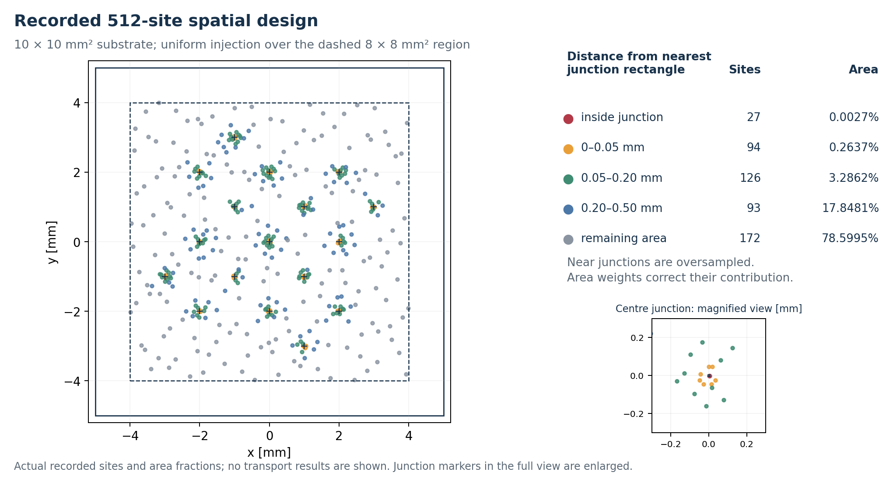
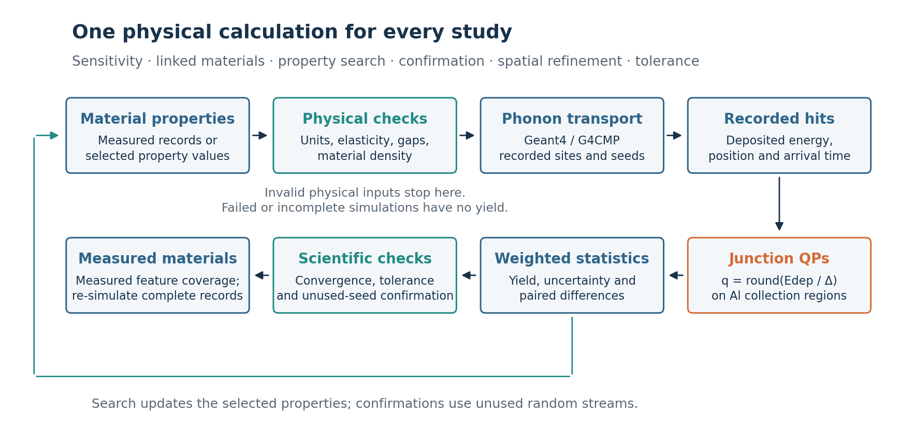
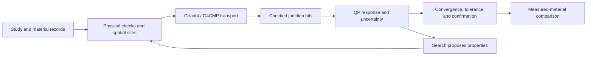

# Material properties and phonon-induced quasiparticles

This project calculates how substrate and film properties change phonon-induced
quasiparticle production in aluminum junction regions. Five Python files run
sensitivity studies, linked-material comparisons, continuous-property searches,
confirmation, spatial refinement, and tolerance checks. Geant4/G4CMP supplies
phonon transport; measured simulation outputs supply every search response.


The supplied illustration shows the goal: redirect and absorb substrate phonons
before they create quasiparticles in junction regions. Paths, layer spacing,
and glowing markers are illustrative; the measured response and actual device
dimensions are defined below.

## Physical quantity

Let $x\in\mathcal X\subset\mathbb R^d$ denote the selected material properties,
$\xi$ an injection position in the declared surface region, $\omega$ a transport
realization, and $e$ a junction region. For $Q_e(x,\xi,\omega)$ quasiparticles per
primary phonon and source energy $E_g$ in eV, the area-weighted objective is

$$
J(x)=\mathbb E_{\xi,\omega}\!\left[
\frac{\sum_e w_e Q_e(x,\xi,\omega)}{E_g}\right],
\qquad w_e\geq0,\quad\sum_e w_e=1.
$$

Its units are weighted junction QPs per injected eV. Each recorded junction hit
with deposited energy $E_k$ contributes $q_k=\operatorname{round}(E_k/\Delta_{\rm Al})$,
where $\Delta_{\rm Al}=191\,\mu\mathrm{eV}$ in the reference. The separately named
`total_qps_per_primary` response sums over junctions without energy normalization.
Studies record which response they use. Density sensitivity instead integrates
the stated quasiparticle evolution equations and retains its own response units.


The reference uses a 525 μm Si substrate, 75 nm Nb upper film, 1 μm Cu bottom
film, and seventeen 120 nm Al junction collection regions. Each collection
rectangle is 10 × 10 μm². The source phonon energy is 10 meV. The drawing shows
boundary regions and illustrative paths; lengths and thicknesses are not to scale.
Only junction hits contribute to the recorded junction-QP response.

## Spatial and statistical comparison

Uniform injection is defined over the region in the study. In the recorded
512-site design below, it covers 8 × 8 mm² within the 10 × 10 mm² substrate.
Near-junction regions are sampled more densely, so their measured means
$\widehat\mu_h$ must be multiplied by their true area fractions $W_h$:
$\widehat J=\sum_h W_h\widehat\mu_h$. An equal average over these sites gives
the wrong spatial integral.



Matched comparisons retain the same sites, source counts, region weights, and
random streams. Repeated realizations provide uncertainty in the difference.
Software equivalence requires the entire stated confidence interval to lie
inside a margin chosen before comparison. An unresolved difference alone does
not demonstrate equivalence. A complete, header-only hit file is a physical
zero; failed, timed-out, or incomplete simulations have no measured response.

## Run and verify

Use the existing G4CMP environment from this repository directory. The study's
`installation` section sets external paths. An optional editable installation,
`python -m pip install --no-deps -e .`, provides the `material-scan` command.

```bash
conda run -n G4CMP python scan.py check studies/reference-eight.yaml
conda run -n G4CMP python scan.py run studies/reference-eight.yaml \
  --output material_scan_data/experiments/reference-eight
conda run -n G4CMP python scan.py analyse \
  material_scan_data/experiments/reference-eight --output /tmp/reference-analysis.json
conda run -n G4CMP python scan.py plot \
  material_scan_data/experiments/reference-eight --kind summary --output /tmp/reference.png
conda run -n G4CMP python -m unittest discover -s tests -v
```

`run --prepare-only` writes resolved inputs without simulation. Repeating `run`
with the same output directory resumes recorded work after checking its physical
inputs and raw outputs. Give a new physical study a new directory. Retained hit
files support reanalysis when only scoring changes.
Older frozen studies require agreement of retained raw files and normalized
inputs before cached analysis; use their `resolved.json` as the study input.
New transport after a source change needs a new output directory. Earlier
search checkpoint schemas require a new study.

The files in [`studies/`](studies/) declare physical limits, source counts,
sites, realizations, seeds, and responses. The small reference examples test
software agreement; sixteen sites do not establish a converged spatial integral.
SALib is needed for Morris sensitivity. Materials Project access, TPE search,
and presentation export have optional dependencies in [`pyproject.toml`](pyproject.toml).

Additional commands are `compare`, `catalog`, `project`, `probe-density`,
`history`, `inventory`, `archive`, `verify-archive`, `recover`, and `convert-copy`.
Use `python scan.py COMMAND --help` for arguments. Archive creation copies data
and verifies its contents. Historical raw data should have two independently
verified copies before any later removal.

<!-- full-scale-start -->
## Fresh full-scale measurements

The fresh queue is defined in [`studies/full_scale/queue.yaml`](studies/full_scale/queue.yaml)
and runs sequentially with [`run_all.sh`](run_all.sh). The main temperature is
20 mK; a matched 0 K reference is also calculated. The continuous search requires
an upper-film gap of at least 1.5384 meV. Linked Ta/Ti material checks keep their
own gaps and are reported separately.

The queue covers spatial refinement, primary-count convergence, the soft
$C_{44}$ limit, transport and density sensitivity, eighteen linked-material
cases, three seeds each for GP and CMA-ES, unused-stream confirmation, physical
tolerances, and SiC rate and interface ranges. Each optimizer must obtain 120
successful measurements; failed or timed-out attempts remain unmeasured.
The algorithms use different initial proposals. Fresh sites are nested from
128 to 512, 2,361 and 4,096; confirmation uses sixteen realizations.

At most half the available CPU affinity is used: on this machine 96 of 192
logical CPUs, with 94 transport workers and one numerical thread per process.
The total RSS limit is 64 GiB, each transport process is limited to 2 GiB, and
16 GiB of available memory and 20 GiB of free disk are reserved. Memory checks
include ancestor cgroup limits. A transport task exceeding six hours is
right-censored. The queue pauses rather than interpreting missing output as zero.
Large tolerance and interface families are split into small batches with matched
centers, sites and random streams.

```bash
bash run_all.sh check
bash run_all.sh prepare
tmux -L material-scan new-session -d -s full_scale_20261014 \
  'bash run_all.sh run > material_scan_data/full_scale_20261014/queue.log 2>&1'
bash run_all.sh status
bash run_all.sh stop
# Resume in a new tmux session with the same run command.
```

Before transport, the queue freezes the five modules, physical inputs,
executable, loaded libraries, lattice maps and Geant4 datasets. Completed stages
are compressed, fully verified, and copied onto the independent `/tmp`
filesystem before their raw working files are removed. Recovery uses
`python scan.py recover ARCHIVE --output DIRECTORY`. The retained summaries
record both archive paths and checksums. After all declared stages finish, the
queue generates numerical results and figures, replaces this section, commits
the report, pushes this branch, and verifies the remote commit. A failed check
or push leaves its records available for inspection and restart.

Started on 2026-10-14 in tmux session `full_scale_20261014`. All 46 stage
definitions pass physical preparation and all 128 tests pass. The first live
study completed eight million primaries at 128 sites and two realizations in
33.0 s: $\widehat J=0.0022550\pm0.0001919$ weighted junction QPs/eV (standard
error). Both archive copies passed verification. This small pilot checks the
workflow; it does not establish spatial convergence or a material improvement.
The queue has advanced to the full-scale temperature comparison.

Full-scale results are pending. The software comparisons below are completed
tests; they are separate from these fresh physical measurements. The
[launch verification](verification/full_scale_launch.json) records the tests,
source sizes, physical preparation checks and pilot archive recovery.
<!-- full-scale-end -->

## Calculation and source files





| File | Responsibility |
|---|---|
| [`scan.py`](scan.py) | Study loading, candidate tables, simulation tasks, execution and commands |
| [`physics.py`](physics.py) | Property maps, physical checks, elasticity, interfaces, sites, QPs and density evolution |
| [`analysis.py`](analysis.py) | Scoring, area weights, uncertainty, sensitivity, convergence, projection and figures |
| [`search.py`](search.py) | Random, Sobol, Gaussian-process and CMA-ES search; optional TPE and Ollama |
| [`records.py`](records.py) | Input records, hit reading, SQLite results, archives and recovery |
| [`run_all.sh`](run_all.sh) | Sequential full-scale studies, resource checks, verified preservation and final report |
| [`tests/`](tests/) | Two test files and small numerical fixtures |

[`verification/round2_results.json`](verification/round2_results.json) records
the numerical comparisons, timing measurements, and source-size counts for this
rewrite. The round-two comparison passed 108 tests and eight example study checks;
the later queue and preservation checks extend that suite. Against revision
`803943e`, the eight-realization reference differs by −0.13%; its paired 95%
interval, [−1.39%, +1.13%], lies within the predefined ±5% margin.

| Source measure at the round-two comparison | Previous | Round two |
|---|---:|---:|
| Working Python files | 8 | 5 |
| Functions and methods, including private definitions | 150 | 126 |
| Project import connections | 13 | 7 |
| Lines, including blanks | 4,391 | 4,300 |

With the later restart, memory and archive checks, the five core modules now
contain 4,466 lines and 128 functions/methods. The full-scale Bash driver adds
555 lines. There are eight active scripts including the two test files; the
extra lines support long runs and preservation rather than another code layer.

Measured medians give 13.0× faster task preparation, 2.9× faster density
evolution, and 1.26× faster complete reference reanalysis. These measurements
have different scopes and cannot be added into a whole-run gain. Software
agreement does not establish new material predictions or a measured transport
speedup. The line count exceeds the earlier estimate because the explicit
verification and preservation checks remain.
The figures above use the [recorded source data](docs/figures/provenance.json);
their [SVG originals](docs/figures/) are also available.

Scientific definitions, earlier measurements, and data instructions remain in
[`material_scan/docs/`](material_scan/docs/). Historical source is preserved in
Git; [`legacy/`](legacy/) contains retained input tables, macros, and notes.
Old simulation outputs were removed after two archive copies passed full content
verification. Their receipt is stored locally at
`material_scan_data/backups/old-runs-verified.json`; the copies are
`material_scan_data/backups/material-old-runs-20261014.tar.gz` and
`/tmp/material-old-runs-20261014.tar.gz`. Numerical test fixtures and input-only
spatial designs remain in Git. New output belongs under the ignored
`material_scan_data/` directory; software and model files under that directory
are retained.

## Scientific limits and next measurements

The response is junction quasiparticle yield under the stated source and
interface models. A qubit-error prediction additionally needs a calibrated
mapping from local quasiparticle density to qubit dynamics. A searched property
set is a target; comparison with measured materials must state missing fields
and retain each material's own density and lattice record.

Later local reports inherited from the previous code describe a 2,361-site
comparison and full-spatial CMA-ES confirmations. Their leading candidates are
statistically tied and reach the $C_{44}=5$ GPa lower search limit. Those reports
are historical evidence, not experiments rerun by this rewrite; verify their
source definitions and recorded inputs before using them for a new study.

1. Fix the intended operating temperature and the Nb-compatible upper-film gap
   limit. Test physical support and tolerance near the $C_{44}$ lower limit.
2. Compare independent GP and CMA-ES searches with equal measured evaluations
   and several optimizer seeds. Confirm finalists on a converged spatial design
   with unused random streams.
3. Obtain measured SiC scattering and decay constants, bracket film lifetimes,
   and test independently justified interface models before fabrication advice.
