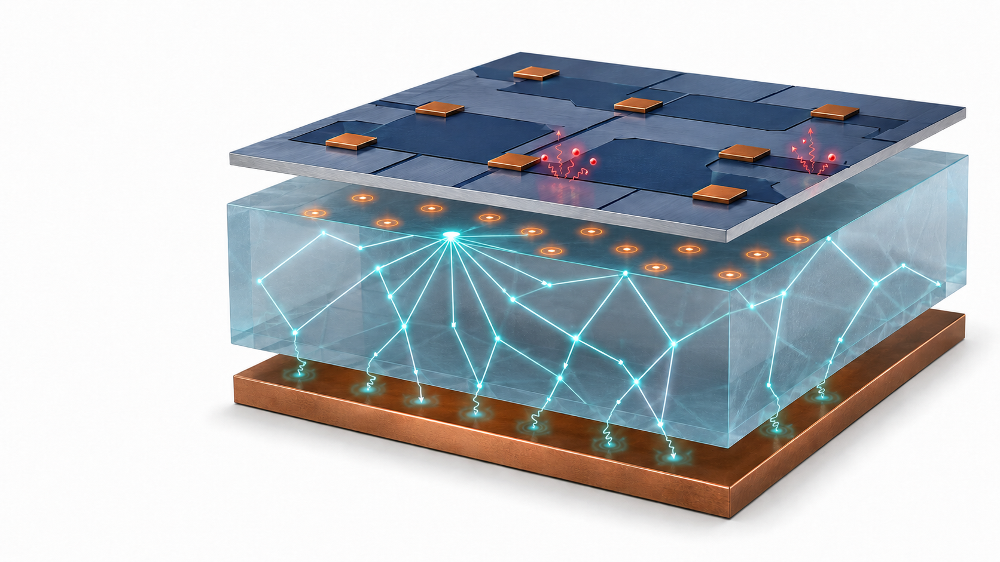
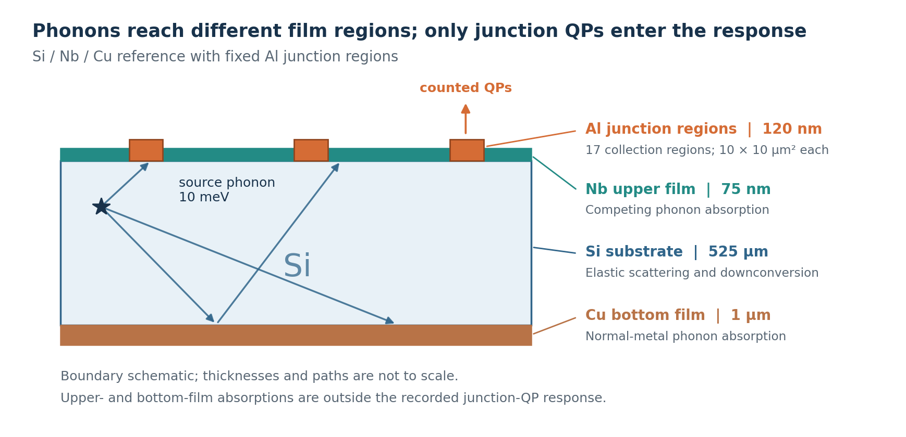
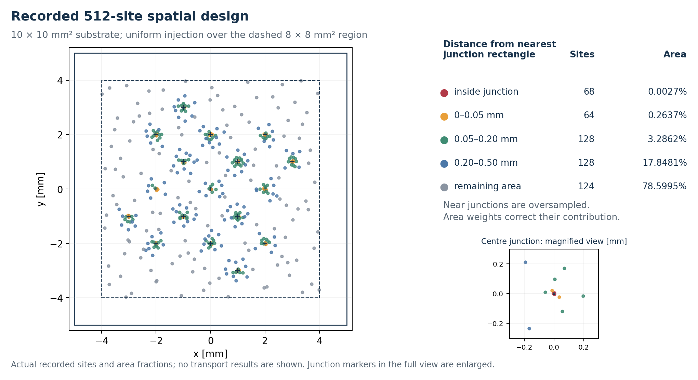
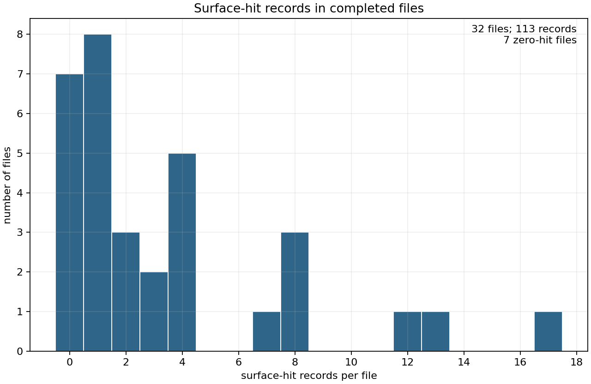
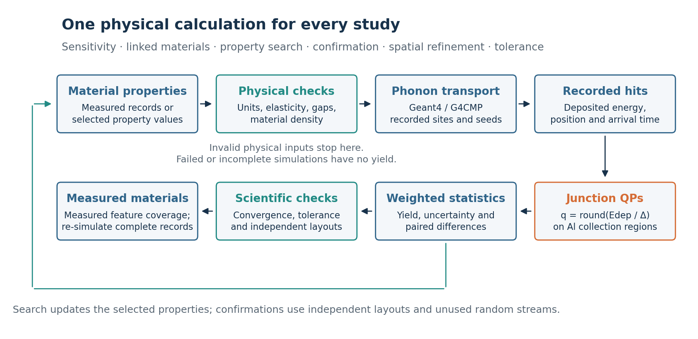
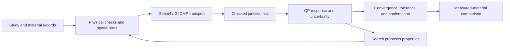

# Material properties and phonon-induced quasiparticles

This project calculates how substrate and film properties change phonon-induced
quasiparticle production in aluminum junction regions. Five Python files run
sensitivity studies, linked-material comparisons, continuous-property searches,
confirmation, spatial refinement, and tolerance checks. Geant4/G4CMP supplies
phonon transport; measured simulation outputs supply every search response.



The supplied illustration shows the goal: redirect and absorb substrate phonons
before they create quasiparticles in junction regions. Paths, layer spacing,
and glowing markers are illustrative; the measured response and actual device
dimensions are defined below.

## Physical quantity

Let $x\in\mathcal X\subset\mathbb R^d$ denote the selected material properties,
$\xi$ an injection position in the declared surface region, $\omega$ a transport
realization, and $e$ a junction region. For $Q_e(x,\xi,\omega)$ quasiparticles per
primary phonon and source energy $E_g$ in eV, the area-weighted objective is

$$
J(x)=\mathbb E_{\xi,\omega}\!\left[
\frac{\sum_e w_e Q_e(x,\xi,\omega)}{E_g}\right],
\qquad w_e\geq0,\quad\sum_e w_e=1.
$$

Its units are weighted junction QPs per injected eV. Each recorded junction hit
with deposited energy $E_k$ contributes $q_k=\operatorname{round}(E_k/\Delta_{\rm Al})$,
where $\Delta_{\rm Al}=191\,\mu\mathrm{eV}$ in the reference. The separately named
`total_qps_per_primary` response sums over junctions without energy normalization.
Studies record which response they use. Density sensitivity instead integrates
the stated quasiparticle evolution equations and retains its own response units.



The reference uses a 525 μm Si substrate, 75 nm Nb upper film, 1 μm Cu bottom
film, and seventeen 120 nm Al junction collection regions. Each collection
rectangle is 10 × 10 μm². The source phonon energy is 10 meV. The drawing shows
boundary regions and illustrative paths; lengths and thicknesses are not to scale.
Only junction hits contribute to the recorded junction-QP response.

## Spatial and statistical comparison

Uniform injection is defined over the region in the study. In the revised
512-site search design below, it covers 8 × 8 mm² within the 10 × 10 mm² substrate.
Near-junction regions are sampled more densely, so their measured means
$\widehat\mu_h$ must be multiplied by their true area fractions $W_h$:
$\widehat J=\sum_h W_h\widehat\mu_h$. An equal average over these sites gives
the wrong spatial integral.



Matched comparisons retain the same sites, source counts, region weights, and
random streams. Repeated realizations provide uncertainty in the difference.
Software equivalence requires the entire stated confidence interval to lie
inside a margin chosen before comparison. An unresolved difference alone does
not demonstrate equivalence. A complete, header-only hit file is a physical
zero; failed, timed-out, or incomplete simulations have no measured response.

## Surface-hit records

For file $f$, let $H_f$ be the number of valid surface-hit rows. The histogram
shows how many files have each count $H_f$. These rows record deposited energy
and the final phonon position and time. A row is a recorded hit, rather than
a unique injected phonon or the junction-QP response defined above.



This historical checking example contains **32 files and 113 surface-hit
records**, including **7 complete files with zero records**, at 125,000 primary
phonons per file. It includes both substrate surfaces: 78 records on the upper
surface and 35 on the lower surface. The plot describes these recorded files;
it does not establish spatial convergence or a material ranking.

```bash
conda run -n G4CMP python figures/plot.py hits tests/fixtures/random_trial_9a3f0ab28d9d/hits \
  --output figures/surface_hits_histogram.png \
  --counts figures/surface_hits_counts.csv
conda run -n G4CMP python figures/draw.py
```

The [per-file counts](figures/surface_hits_counts.csv) retain the inputs to this
histogram. The [verification record](verification/hit_figures_checks.json)
records **160 passing tests**, including the hit-file and plotting checks.
A recorded study directory selects only completed tasks and checks
their saved file checksums. Direct raw-file input should contain completed
measurements; task directories also require the post-transport completion marker.
The drawings use the [recorded spatial sites](figures/spatial_sites.json)
and current reference dimensions. `draw.py --design FILE --output-dir DIRECTORY`
selects another saved design or destination. Both figure scripts and the supplied
`device_stack.png` are under `figures/`; full-scale result plots also go there.

## Run and verify

Use the existing G4CMP environment from this repository directory. The study's
`installation` section sets external paths. An optional editable installation,
`python -m pip install --no-deps -e .`, provides the `material-scan` command.

```bash
conda run -n G4CMP python scan.py check studies/reference-eight.yaml
conda run -n G4CMP python scan.py run studies/reference-eight.yaml \
  --output material_scan_data/experiments/reference-eight
conda run -n G4CMP python scan.py analyse \
  material_scan_data/experiments/reference-eight --output /tmp/reference-analysis.json
conda run -n G4CMP python scan.py plot \
  material_scan_data/experiments/reference-eight --kind summary --output figures/reference_summary.png
conda run -n G4CMP python -m unittest discover -s tests -v
```

`run --prepare-only` writes resolved inputs without simulation. Repeating `run`
with the same output directory resumes recorded work after checking its physical
inputs and raw outputs. Give a new physical study a new directory. Retained hit
files support reanalysis when only scoring changes.
Older frozen studies require agreement of retained raw files and normalized
inputs before cached analysis; use their `resolved.json` as the study input.
New transport after a source change needs a new output directory. Earlier
search checkpoint schemas require a new study.

The files in [`studies/`](studies/) declare physical limits, source counts,
sites, realizations, seeds, and responses. The small reference examples test
software agreement; sixteen sites do not establish a converged spatial integral.
SALib is needed for Morris sensitivity. Materials Project access, TPE search,
and presentation export have optional dependencies in [`pyproject.toml`](pyproject.toml).

Additional commands are `compare`, `catalog`, `project`, `probe-density`,
`history`, `inventory`, `archive`, `verify-archive`, `recover`, and `convert-copy`.
Use `python scan.py COMMAND --help` for arguments. Archive creation copies data
and verifies its contents. Historical raw data should have two independently
verified copies before any later removal.

<!-- full-scale-start -->
## Revised full-scale measurements

The revised queue in [`studies/full_scale/queue.yaml`](studies/full_scale/queue.yaml)
retains complete evidence from `material_scan_data/full_scale_20261014` and adds
the missing validation. Prepared on 2026-10-14, with **151 tests passing**
and all 53 stage declarations checked. Tmux session
`full_scale_20261014_revised` is waiting for `source-2361` to finish and be
preserved before starting the revised queue. At 21:54 EDT, that comparison
had 49,542 of 56,664 transport tasks complete; about
24 minutes of transport remained at its observed average rate,
followed by archive verification. The four completed studies, including the 0 K and 20 mK comparisons, are retained. The main temperature remains 20 mK.
The continuous search requires an upper-film
gap of at least 1.5384 meV. Linked Ta/Ti checks retain their own gaps.

The recorded 2,361-site layout is extended to 2,653 and then 3,041 sites without
changing earlier positions or area weights. The five regions are the junctions
($S_0$), the successive 0.05, 0.20 and 0.50 mm distance bands ($S_1,S_2,S_3$),
and the remaining source area ($S_4$). Explicit counts ensure that added sites
resolve near-junction variation:

| Sites | $S_0$ | $S_1$ | $S_2$ | $S_3$ | $S_4$ |
|---|---:|---:|---:|---:|---:|
| 128 | 34 | 16 | 24 | 24 | 30 |
| 512 | 68 | 64 | 128 | 128 | 124 |
| 2,653 | 68 | 64 | 256 | 415 | 1,850 |
| 3,041 | 136 | 128 | 512 | 415 | 1,850 |

Spatial checks use eight transport realizations and 62,500 primaries per task.
The confidence interval for the total and each refined region's change must
fit within the declared ±5% margin. Four independent position layouts then
check the selected 2,653- or 3,041-site resolution. Their mean must also agree
with the retained layout's estimate: the entire 95% difference interval must
fit inside ±5% of the independent mean. This interval combines the layout and
retained hierarchical standard errors in quadrature and uses a conservative
Student-t critical value with three degrees of freedom. Area weights remain
fixed and regional shifts are reported. Source validation stops the queue
before the remaining expensive studies if required interval containment fails
or the independent-layout relative standard error exceeds 2%. Passing supports
statistical equivalence of the integral approximations under these assumptions;
systematic bias may remain. Extra primaries alone cannot resolve uncertainty
from source positions.

The queue also covers primary-count convergence, the soft $C_{44}$ limit,
transport and density sensitivity, eighteen linked-material cases, and three
seeds each for GP and CMA-ES. Search uses the 512-site allocation above and
requires 120 successful measurements per optimizer; incomplete attempts have
no measured response. Finalists and anchors are confirmed on four additional
independent layouts with sixteen realizations and unused transport streams.
Physical-tolerance checks measure the two selected centers once; rate and
interface checks measure their three centers once. Perturbation batches reuse
those centers with matched positions and streams. These checks test the stated
model assumptions and do not establish measured SiC coefficients or validated
interface transmission.

[`run_all.sh`](run_all.sh) executes the stages sequentially and freezes the
five modules, physical inputs, executable, libraries, lattice maps and Geant4
datasets before transport. The revised output directory is
`material_scan_data/full_scale_20261014_revised`; repeat `run` to resume checked
work. The planned launch uses its own tmux session after transition verification:

```bash
bash run_all.sh check material_scan_data/full_scale_20261014_revised
bash run_all.sh prepare material_scan_data/full_scale_20261014_revised
tmux -L material-scan new-session -d -s full_scale_20261014_revised \
  'bash run_all.sh run material_scan_data/full_scale_20261014_revised > material_scan_data/full_scale_20261014_revised/queue.log 2>&1'
bash run_all.sh status material_scan_data/full_scale_20261014_revised
bash run_all.sh stop material_scan_data/full_scale_20261014_revised
```

At most half the available CPU affinity is used: on this machine 96 of 192
logical CPUs, with 94 transport workers and one numerical thread per process.
The total RSS limit is 64 GiB, each transport process is limited to 2 GiB, and
16 GiB of available memory and 20 GiB of free disk are reserved. Memory checks
include ancestor cgroup limits. A task exceeding six hours is right-censored;
missing output never supplies a zero response.

Completed stages are compressed, fully verified, and retained both under
`material_scan_data/` and on the independent persistent filesystem at
`/data/htseng/material-scan-archives`. Both copies must pass verification before
raw working files are removed. Recovery uses
`python scan.py recover ARCHIVE --output DIRECTORY`. Summaries record both
archive paths and checksums. Once all declared stages finish, numerical results,
figures and publication status are refreshed from the completed evidence. Both
frozen source and Geant4 snapshots also have verified archives on `/data`.

Full-scale results remain pending. The original
[launch verification](verification/full_scale_launch.json) and
[timing record](verification/full_scale_eta_20261014.json) describe the earlier
queue; they do not establish the revised launch or its completion date. The
software comparisons below remain separate from these transport measurements.

The declared revised work is approximately **566–634 billion primary phonons**,
depending on spatial refinement and before physically infeasible moves are
removed. At 0.25–0.40 million primaries/s with 10–20% additional processing, the
conditional completion estimate remains **about 3–5 weeks**. Reusing centers
avoids 58 repeated measurements: 154–176 billion primaries at the revised site
counts. Four independent confirmation layouts provide stronger spatial checks,
so the whole queue is not expected to gain the full time saved by center reuse.
The [verification and timing record](verification/revised_queue_checks.json)
contains the measured progress, source checks, design checks, and assumptions.
A failed spatial check stops before further expensive work and requires a new
position study; this timing range assumes the declared checks pass.

<!-- full-scale-end -->

## Calculation and source files





| File | Responsibility |
|---|---|
| [`scan.py`](scan.py) | Study loading, candidate tables, simulation tasks, execution and commands |
| [`physics.py`](physics.py) | Property maps, physical checks, elasticity, interfaces, sites, QPs and density evolution |
| [`analysis.py`](analysis.py) | Scoring, area weights, uncertainty, sensitivity, convergence and projection |
| [`search.py`](search.py) | Random, Sobol, Gaussian-process and CMA-ES search; optional TPE and Ollama |
| [`records.py`](records.py) | Input records, hit reading, SQLite results, archives and recovery |
| [`figures/plot.py`](figures/plot.py) | Hit-file counts and plots of recorded results |
| [`figures/draw.py`](figures/draw.py) | Device schematic, recorded spatial sites and workflow diagram |
| [`run_all.sh`](run_all.sh) | Sequential full-scale studies, resource checks, verified preservation and final report |
| [`tests/`](tests/) | Two test files and small numerical fixtures |

[`verification/round2_results.json`](verification/round2_results.json) records
the numerical comparisons, timing measurements, and source-size counts for this
rewrite. The round-two comparison passed 108 tests and eight example study checks;
the later queue and preservation checks extend that suite. Against revision
`803943e`, the eight-realization reference differs by −0.13%; its paired 95%
interval, [−1.39%, +1.13%], lies within the predefined ±5% margin.

| Source measure at the round-two comparison | Previous | Round two |
|---|---:|---:|
| Working Python files | 8 | 5 |
| Functions and methods, including private definitions | 150 | 126 |
| Project import connections | 13 | 7 |
| Lines, including blanks | 4,391 | 4,300 |

At the original queue launch, the five core modules including restart, memory and archive
checks contained 4,466 lines and 128 functions/methods. The Bash driver added
555 lines. That version had eight active scripts including the two test files.
The current layout has **ten scripts**: five scientific modules, two figure
scripts, one Bash driver and two test files. Plotting now lives in
[`figures/`](figures/) together with images and their recorded inputs.

Short code annotations use $x$ for physical properties, $u\in[0,1]^d$ for
normalized coordinates, and $N_{ire}$ for summed QPs at site $i$, realization
$r$, and junction $e$. Thus $Q_{ire}=N_{ire}/N_p$ per primary, with $N_p$
primaries per task. The junction weights $w_e$ and area fractions $W_h$ retain
the definitions above. Density evolution uses $z_e=n_{{\rm qp},e}/n_{\rm cp}$.

Measured medians give 13.0× faster task preparation, 2.9× faster density
evolution, and 1.26× faster complete reference reanalysis. These measurements
have different scopes and cannot be added into a whole-run gain. Software
agreement does not establish new material predictions or a measured transport
speedup. The line count exceeds the earlier estimate because the explicit
verification and preservation checks remain.
The figures above use the [recorded source data](figures/provenance.json);
their [SVG originals](figures/) are also available.

Scientific definitions, earlier measurements, and data instructions remain in
[`material_scan/docs/`](material_scan/docs/). Historical source is preserved in
Git; [`legacy/`](legacy/) contains retained input tables, macros, and notes.
Old simulation outputs were removed after two archive copies passed full content
verification. Their receipt is stored locally at
`material_scan_data/backups/old-runs-verified.json`; the copies are
`material_scan_data/backups/material-old-runs-20261014.tar.gz` and
`/data/htseng/material-scan-archives/historical/material-old-runs-20261014.tar.gz`. Numerical test fixtures and input-only
spatial designs remain in Git. New output belongs under the ignored
`material_scan_data/` directory; software and model files under that directory
are retained.

## Scientific limits and next measurements

The response is junction quasiparticle yield under the stated source and
interface models. A qubit-error prediction additionally needs a calibrated
mapping from local quasiparticle density to qubit dynamics. A searched property
set is a target; comparison with measured materials must state missing fields
and retain each material's own density and lattice record.

Later local reports inherited from the previous code describe a 2,361-site
comparison and full-spatial CMA-ES confirmations. Their leading candidates are
statistically tied and reach the $C_{44}=5$ GPa lower search limit. Those reports
are historical evidence, not experiments rerun by this rewrite; verify their
source definitions and recorded inputs before using them for a new study.

1. Fix the intended operating temperature and the Nb-compatible upper-film gap
   limit. Test physical support and tolerance near the $C_{44}$ lower limit.
2. Compare independent GP and CMA-ES searches with equal measured evaluations
   and several optimizer seeds. Confirm finalists on a converged spatial design
   with unused random streams.
3. Obtain measured SiC scattering and decay constants, bracket film lifetimes,
   and test independently justified interface models before fabrication advice.
