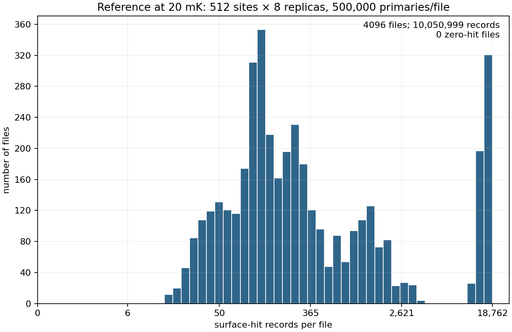
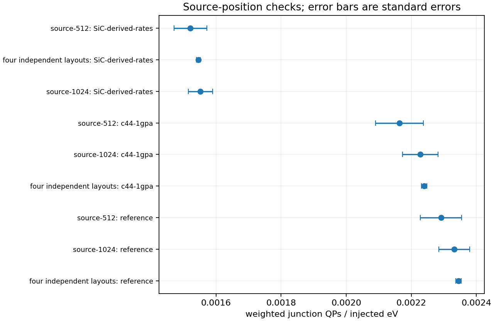
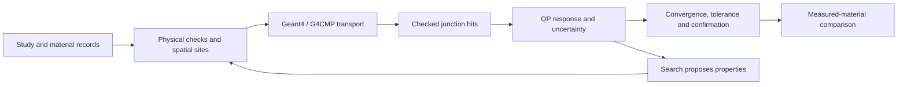

# Material properties and phonon-induced quasiparticles

This project calculates how substrate and film properties change phonon-induced
quasiparticle production in aluminum junction regions. Five Python files run
sensitivity studies, linked-material comparisons, continuous-property searches,
confirmation, spatial refinement, and tolerance checks. Geant4/G4CMP supplies
phonon transport; measured simulation outputs supply every search response.


The supplied illustration shows the goal: redirect and absorb substrate phonons
before they create quasiparticles in junction regions. Paths, layer spacing,
and glowing markers are illustrative; the measured response and actual device
dimensions are defined below.

## Physical quantity

Let $x\in\mathcal X\subset\mathbb R^d$ denote the selected material properties,
$\xi$ an injection position in the declared surface region, $\omega$ a transport
realization, and $e$ a junction region. For $Q_e(x,\xi,\omega)$ quasiparticles per
primary phonon and source energy $E_g$ in eV, the area-weighted objective is

$$
J(x)=\mathbb E_{\xi,\omega}\!\left[
\frac{\sum_e w_e Q_e(x,\xi,\omega)}{E_g}\right],
\qquad w_e\geq0,\quad\sum_e w_e=1.
$$

Its units are weighted junction QPs per injected eV. Each recorded junction hit
with deposited energy $E_k$ contributes $q_k=\operatorname{round}(E_k/\Delta_{\rm Al})$,
where $\Delta_{\rm Al}=191\,\mu\mathrm{eV}$ in the reference. The separately named
`total_qps_per_primary` response sums over junctions without energy normalization.
Studies record which response they use. Density sensitivity instead integrates
the stated quasiparticle evolution equations and retains its own response units.


The reference uses a 525 μm Si substrate, 75 nm Nb upper film, 1 μm Cu bottom
film, and seventeen 120 nm Al junction collection regions. Each collection
rectangle is 10 × 10 μm². The source phonon energy is 10 meV. The drawing shows
boundary regions and illustrative paths; lengths and thicknesses are not to scale.
Only junction hits contribute to the recorded junction-QP response.

## Spatial and statistical comparison

Uniform injection is defined over the region in the study. In the revised
512-site search design below, it covers 8 × 8 mm² within the 10 × 10 mm² substrate.
Near-junction regions are sampled more densely, so their measured means
$\widehat\mu_h$ must be multiplied by their true area fractions $W_h$:
$\widehat J=\sum_h W_h\widehat\mu_h$. An equal average over these sites gives
the wrong spatial integral.


Matched comparisons retain the same sites, source counts, region weights, and
random streams. Repeated realizations provide uncertainty in the difference.
Software equivalence requires the entire stated confidence interval to lie
inside a margin chosen before comparison. An unresolved difference alone does
not demonstrate equivalence. A complete, header-only hit file is a physical
zero; failed, timed-out, or incomplete simulations have no measured response.

## Surface-hit records

For file $f$, let $H_f$ be the number of valid surface-hit rows. The histogram
shows how many files have each count $H_f$. These rows record deposited energy
and final phonon position and time. A row is a recorded boundary hit; it is
neither a distinct injected phonon nor the junction-QP response defined above.



This new example uses **all 4,096 completed reference files** from the
`events-500000` study: 512 positions × 8 realizations at 20 mK, with 500,000
primaries per file. It contains **10,050,999 records**: 5,733,757 upper-surface,
4,297,824 lower-surface and 19,418 side-boundary records. No file has zero hits;
the median is 213 records/file and the range is 12–18,762. Bins are equally
spaced in $\log(1+H_f)$; horizontal labels show raw counts. The file histogram
retains the deliberate near-junction oversampling and is not an area-weighted
physical source distribution.

The [per-file counts](figures/surface_hits_events500000_reference.csv) and
[provenance and reproduction command](figures/surface_hits_events500000_reference.json)
retain archive-relative paths, positions, realizations and checksums. The
archive, hit files, completion markers and saved per-file counts agree. All
recorded boundaries are counted, including zero deposited energy when present;
this particular cohort has no zero-energy rows. These counts do not establish
spatial convergence or rank materials.

The [historical 32-file checking example](figures/surface_hits_histogram.png)
remains available. To regenerate that small example and the device drawings:

```bash
conda run -n G4CMP python figures/plot.py hits tests/fixtures/random_trial_9a3f0ab28d9d/hits \
  --output figures/surface_hits_histogram.png \
  --counts figures/surface_hits_counts.csv
conda run -n G4CMP python figures/draw.py
```

A recorded study directory selects completed tasks and checks saved hit-file
checksums. Direct raw-file input should contain completed measurements; task
directories also require the post-transport completion marker. Archived studies
must be recovered before recounting raw hits. The new plot can also be
regenerated from its tracked count table using the command in its provenance.
Both figure scripts, all images and the supplied `device_stack.png` are under
`figures/`. The drawings use the [recorded sites](figures/spatial_sites.json)
and current reference dimensions.

## Run and verify

Use the existing G4CMP environment from this repository directory. The study's
`installation` section sets external paths. An optional editable installation,
`python -m pip install --no-deps -e .`, provides the `material-scan` command.

```bash
conda run -n G4CMP python scan.py check studies/reference-eight.yaml
conda run -n G4CMP python scan.py run studies/reference-eight.yaml \
  --output material_scan_data/experiments/reference-eight
conda run -n G4CMP python scan.py analyse \
  material_scan_data/experiments/reference-eight --output /tmp/reference-analysis.json
conda run -n G4CMP python scan.py plot \
  material_scan_data/experiments/reference-eight --kind summary --output figures/reference_summary.png
conda run -n G4CMP python -m unittest discover -s tests -v
```

`run --prepare-only` writes resolved inputs without simulation. Repeating `run`
with the same output directory resumes recorded work after checking its physical
inputs and raw outputs. Give a new physical study a new directory. Retained hit
files support reanalysis when only scoring changes.
Older frozen studies require agreement of retained raw files and normalized
inputs before cached analysis; use their `resolved.json` as the study input.
New transport after a source change needs a new output directory. Earlier
search checkpoint schemas require a new study.

The files in [`studies/`](studies/) declare physical limits, source counts,
sites, realizations, seeds, and responses. The small reference examples test
software agreement; sixteen sites do not establish a converged spatial integral.
SALib is needed for Morris sensitivity. Materials Project access, TPE search,
and presentation export have optional dependencies in [`pyproject.toml`](pyproject.toml).

Additional commands are `compare`, `catalog`, `project`, `probe-density`,
`history`, `inventory`, `archive`, `verify-archive`, `recover`, and `convert-copy`.
Use `python scan.py COMMAND --help` for arguments. Archive creation copies data
and verifies its contents. Historical raw data should have two independently
verified copies before any later removal.

<!-- full-scale-start -->
## Source and primary-count comparisons up to 1,024 sites

The queue in [`studies/full_scale/queue.yaml`](studies/full_scale/queue.yaml)
is limited to **1,024 source sites** and stops after the initial comparisons.
The unfinished 2,653-site study was cancelled on 2026-10-14. Its 6,105 completed
task measurements are retained separately from 57,567 unmeasured tasks; this
partial study supplies no complete candidate comparison. Earlier completed
measurements, including the 2,361-site comparison and the 0 K/20 mK checks,
remain historical evidence. No further study above 1,024 sites will start.

The source remains uniform over 8 × 8 mm² at 20 mK, with 10 meV primary phonons.
The upper-film gap restriction remains 1.5384 meV. The five spatial regions are
junction rectangles ($S_0$), successive distance bands of 0.05, 0.20 and 0.50 mm
($S_1,S_2,S_3$), and the remaining source area ($S_4$):

| Sites | $S_0$ | $S_1$ | $S_2$ | $S_3$ | $S_4$ |
|---|---:|---:|---:|---:|---:|
| 128 | 34 | 16 | 24 | 24 | 30 |
| 512 | 68 | 64 | 128 | 128 | 124 |
| 1,024 | 136 | 128 | 256 | 256 | 248 |

The recorded corrected 512 sites and region area fractions $W_h$ remain fixed.
The 1,024-site layout appends positions within each region. Its nested comparison
recomputes the 512-site estimate from the shared prefix of the same outputs,
retaining covariance. A separate 512-site study uses its own transport streams.
Four independently generated 1,024-site layouts measure position uncertainty.

| Comparison | Sites | Realizations | Primaries per task | Candidates |
|---|---:|---:|---:|---:|
| Pilot | 128 | 2 | 31,250 | 1 |
| Nested layouts | 512 and 1,024 | 8 | 62,500 | 3 |
| Four independent layouts | 1,024 each | 8 | 62,500 | 3 |
| Primary-count variation | 512 | 8 | 31,250; 125,000; 500,000 | 2 |

The spatial candidates are the reference, the $C_{44}=1$ GPa test and the
SiC-derived model. Primary-count checks use the first two. Spatial checks
report 95% intervals for the total and each refined region, a ±5% equivalence
margin, a 2% relative standard-error criterion for independent layouts, and a
10% upper limit on any single site's contribution to the estimated total.
Primary-count errors condition on the fixed source positions. All results and
failed criteria are retained. **The 1,024-site limit does not establish spatial
convergence.** The queue stops for review after these checks, regardless of
whether they pass. These diagnostic checks are retained. The newly authorized optimization comparison
is described below; linked-material, tolerance and model-range extensions remain
separate future studies.

[`run_all.sh`](run_all.sh) freezes the scientific code, physical inputs,
executable, libraries, lattice maps and Geant4 datasets before transport.
The new run directory and tmux session are `initial_checks_1024_20261014`:

```bash
MATERIAL_QUEUE_CONFIG=studies/full_scale/queue.yaml bash run_all.sh check \
  material_scan_data/initial_checks_1024_20261014
bash run_all.sh status material_scan_data/initial_checks_1024_20261014
```

All **10 measured studies and one source-validation step are complete**:
160,000 completed tasks and **13.832 billion primary phonons**. The queue ran
from October 14 at 22:55:40 to October 15 at **10:38:38 EDT**, taking **11 h 43 min**.
This falls within the earlier 11–19 h estimate. This diagnostic queue has no remaining transport. The new optimization queue
uses a separate directory and immutable source snapshot.

At most half the available CPU affinity is used: 96 of 192 logical CPUs on this
machine, with 94 transport workers and one numerical thread per process.
The total RSS limit is 64 GiB, each transport process is limited to 2 GiB,
and 16 GiB of available memory and 20 GiB of free disk are reserved. Memory
checks include ancestor cgroup limits. Failed, incomplete or timed-out tasks
have no measured response.

Completed studies have two fully verified archive copies: under
`material_scan_data/` and on the independent persistent filesystem at
`/data/htseng/material-scan-archives`. Raw working files are removed only after
both copies pass verification. The cancelled partial study is also preserved
in two verified archives, with its raw files retained. Recovery uses
`python scan.py recover ARCHIVE --output DIRECTORY`.

<!-- initial-checks-start -->
### Completed source and primary-count checks

Primary-count comparisons passed at 125,000 and 500,000 primaries per task.
Spatial equivalence remains unconfirmed: nested total changes are small
(0.71–2.75%), but their 95% intervals extend beyond ±5%; some near-junction
regional changes are larger. Four independent 1,024-site layouts give:

| Predefined case | $J$, QPs/injected eV | Standard error | Paired reduction from reference, 95% interval |
|---|---:|---:|---:|
| Reference | 0.00234472 | 0.00000806 | — |
| $C_{44}=1$ GPa | 0.00223919 | 0.00000840 | 4.50% [2.99%, 6.00%] |
| SiC-derived model | 0.00154571 | 0.00000634 | 34.08% [32.98%, 35.17%] |

These are specified test points, not optimizer discoveries. The SiC rates and
interfaces remain model assumptions. Increasing primaries mainly reduces
transport noise; uncertainty from source positions still needs examination.
The 1,024-site cap remains a chosen stopping point.



Error bars are standard errors. The four-layout means include variation between
independent source layouts. [Measured results and uncertainty definitions](docs/results/initial_checks_summary.md)
and [regional checks and archive verification](verification/initial_1024_results.json)
retain the failed criteria. All twenty study-archive copies match their recorded
checksums. The queue is stopped at `awaiting_review`.
<!-- initial-checks-end -->

<!-- full-scale-end -->

## What optimization has contributed

The strongest relevant historical result is the 20 mK, Nb-gap-constrained
CMA-ES search. Three runs improved a shared measured starting point; their
independent confirmations reduced $J$ by **38.7–48.3% beyond the compatible
starting anchor**. That anchor was already 74.8% below its matched reference.
CMA-ES added another **9.8–12.2 percentage points of reference-relative reduction**,
reaching **84.6–87.0% total reduction**. Seeds 101 and 303 remain statistically
tied, and all finalists reach the $C_{44}=5$ GPa search limit. These are
historical model results, not fresh confirmations or a proven global minimum.

Earlier reported screening values place Bayesian search **23.8% below the best
Sobol value and 45.1% below the best random value**. Those lowest points violate
the present gap requirement, and the archived tables do not establish equal
fresh computation. The later constrained BO attempt stalled before completing
a new measurement: its improvement is unmeasured. No fresh BO, CMA-ES, TPE or
agentic optimization ran in the completed diagnostic queue.

The next useful steps are to analyze balanced 512-site subsets of the saved
independent 1,024-site outputs, then compare BO, CMA-ES, Sobol and random over
three seeds with common starting measurements and recorded runtime. Initially
vary only four to six supported properties and use moderate primary counts;
confirm leaders with independent layouts at at most 1,024 sites. Selecting
expected improvement per predicted time, with completion probability, addresses
the earlier BO stall. No new simulations have been started.

Agentic AI has **no measured optimization gain here yet**. It may help with
physical ranges, literature and candidate proposals, but should be compared
against reliable GP search using the same measurements and including inference
time. The local model service is unavailable; its prompt also needs the correct
objective units and measurement errors before testing.

[Detailed measured contributions and proposed comparisons](material_scan/docs/optimization.md)
include exact values, uncertainties, code changes needed and primary research
sources. The [numerical audit](verification/optimizer_contributions.json)
identifies the original historical records.

## Calculation and source files




| File | Responsibility |
|---|---|
| [`scan.py`](scan.py) | Study loading, candidate tables, simulation tasks, execution and commands |
| [`physics.py`](physics.py) | Property maps, physical checks, elasticity, interfaces, sites, QPs and density evolution |
| [`analysis.py`](analysis.py) | Scoring, area weights, uncertainty, sensitivity, convergence and projection |
| [`search.py`](search.py) | Random, Sobol, Gaussian-process and CMA-ES search; optional TPE and Ollama |
| [`records.py`](records.py) | Input records, hit reading, SQLite results, archives and recovery |
| [`figures/plot.py`](figures/plot.py) | Hit-file counts and plots of recorded results |
| [`figures/draw.py`](figures/draw.py) | Device schematic, recorded spatial sites and workflow diagram |
| [`run_all.sh`](run_all.sh) | Sequential full-scale studies, resource checks, verified preservation and final report |
| [`tests/`](tests/) | Two test files and small numerical fixtures |

[`verification/round2_results.json`](verification/round2_results.json) records
the numerical comparisons, timing measurements, and source-size counts for this
rewrite. The round-two comparison passed 108 tests and eight example study checks;
the later queue and preservation checks extend that suite. Against revision
`803943e`, the eight-realization reference differs by −0.13%; its paired 95%
interval, [−1.39%, +1.13%], lies within the predefined ±5% margin.

| Source measure at the round-two comparison | Previous | Round two |
|---|---:|---:|
| Working Python files | 8 | 5 |
| Functions and methods, including private definitions | 150 | 126 |
| Project import connections | 13 | 7 |
| Lines, including blanks | 4,391 | 4,300 |

At the original queue launch, the five core modules including restart, memory and archive
checks contained 4,466 lines and 128 functions/methods. The Bash driver added
555 lines. That version had eight active scripts including the two test files.
The current layout has **ten scripts**: five scientific modules, two figure
scripts, one Bash driver and two test files. Plotting now lives in
[`figures/`](figures/) together with images and their recorded inputs.

Short code annotations use $x$ for physical properties, $u\in[0,1]^d$ for
normalized coordinates, and $N_{ire}$ for summed QPs at site $i$, realization
$r$, and junction $e$. Thus $Q_{ire}=N_{ire}/N_p$ per primary, with $N_p$
primaries per task. The junction weights $w_e$ and area fractions $W_h$ retain
the definitions above. Density evolution uses $z_e=n_{{\rm qp},e}/n_{\rm cp}$.

Measured medians give 13.0× faster task preparation, 2.9× faster density
evolution, and 1.26× faster complete reference reanalysis. These measurements
have different scopes and cannot be added into a whole-run gain. Software
agreement does not establish new material predictions or a measured transport
speedup. The line count exceeds the earlier estimate because the explicit
verification and preservation checks remain.
The figures above use the [recorded source data](figures/provenance.json);
their [SVG originals](figures/) are also available.

Scientific definitions, earlier measurements, and data instructions remain in
[`material_scan/docs/`](material_scan/docs/). Historical source is preserved in
Git; [`legacy/`](legacy/) contains retained input tables, macros, and notes.
Old simulation outputs were removed after two archive copies passed full content
verification. Their receipt is stored locally at
`material_scan_data/backups/old-runs-verified.json`; the copies are
`material_scan_data/backups/material-old-runs-20261014.tar.gz` and
`/data/htseng/material-scan-archives/historical/material-old-runs-20261014.tar.gz`. Numerical test fixtures and input-only
spatial designs remain in Git. New output belongs under the ignored
`material_scan_data/` directory; software and model files under that directory
are retained.

## Scientific limits and next measurements

The response is junction quasiparticle yield under the stated source and
interface models. A qubit-error prediction additionally needs a calibrated
mapping from local quasiparticle density to qubit dynamics. A searched property
set is a target; comparison with measured materials must state missing fields
and retain each material's own density and lattice record.

Later local reports inherited from the previous code describe a 2,361-site
comparison and full-spatial CMA-ES confirmations. Their leading candidates are
statistically tied and reach the $C_{44}=5$ GPa lower search limit. Those reports
are historical evidence, not experiments rerun by this rewrite; verify their
source definitions and recorded inputs before using them for a new study.

1. Fix the intended operating temperature and the Nb-compatible upper-film gap
   limit. Test physical support and tolerance near the $C_{44}$ lower limit.
2. Compare independent GP and CMA-ES searches with equal measured evaluations
   and several optimizer seeds. Confirm finalists on a converged spatial design
   with unused random streams.
3. Obtain measured SiC scattering and decay constants, bracket film lifetimes,
   and test independently justified interface models before fabrication advice.


<!-- optimization-start -->
## Optimization experiments: October 19 restart

The current run is `optimization_20261019_restart`: **70 sequential stages**
using the [recorded search inputs](studies/optimization/queue_restart.yaml) and
[additional physical comparisons](studies/optimization/refinement.yaml).
The temperature is 20 mK, the upper-film gap is at least 1.5384 meV, and every
source layout has at most **1,024 positions**. The calculation minimizes
$J$, the area- and junction-weighted quasiparticle response per injected eV;
it does not calculate qubit error.

The restart retains **23 complete CPU studies**, representing **21.76 billion
primary phonons**, after checking unchanged physical code, executable, material
records, positions, stage definitions and two archive copies. All AI studies
repeat from their shared measured starts under the revised inference procedure.
Earlier measurements, including partial AI studies, remain unchanged.

Twelve calibration cases select the fixed physical background. Search varies
$C_{11},C_{12},C_{44}$, upper-film gap $\Delta_t$, and upper- and lower-film
phonon lifetimes $\tau_t,\tau_b$. Three independent search seeds share **24
measured starting points per seed**, followed by **32 new complete responses
per method**:

| Method | Selection of the next point |
|---|---|
| Random | Uniform draws in normalized coordinates |
| Sobol | Scrambled Sobol points |
| CMA-ES | Covariance adaptation from the best shared starting point |
| BO | Gaussian-process expected improvement |
| Improved BO | Adaptive local range; completion probability and predicted time |
| LLM proposals + improved BO | Eight bounded model proposals added to the ordinary pool |
| LLM checks + improved BO | Same proposals, with at most two source or numerical checks |
| BO with noise-aware refinement (`bo_robust`) | Distinct proposals; local improvement must exceed transport error |
| Corners and coordinate refinement (`corners`) | Sixteen valid corners, followed by decreasing coordinate steps |

The first seven methods preserve the original comparison. The two added methods
are exploratory responses to the earlier screening results. In particular, the
original local BO repeatedly measured nearly identical boundary points. For the
new BO method, normalized coordinates $u\in[0,1]^6$ obey
$\min_j\|u-u_j\|_\infty\geq0.01$ relative to earlier and pending proposals.
A local step counts as successful only when both

$$
J_{\rm old}-J_{\rm new}>0.05J_{\rm old},\qquad
J_{\rm old}-J_{\rm new}>1.645\sqrt{s_{T,\rm old}^2+s_{T,\rm new}^2}.
$$

Here $s_T$ is transport standard error at fixed positions. This rule guides
search; independent confirmation determines the reported improvement. Two
local-range reductions trigger a fresh local range and four global proposal
steps. The new method omits predicted-time weighting so that low response,
rather than short transport time, determines the comparison.

Two further studies use common positions and matched transport streams within
each group. **Seventeen physical changes** test the best boundary target,
elastic constants, gap, film lifetimes and crystal orientation. **Six native
material combinations** use Si, Ge or GaAs with Nb and Cu or Au, retaining each
substrate's density and lattice records. Borrowed interface inputs and film
lifetimes remain model assumptions. Independently varying elastic constants
defines a physical-property target, not an identified material.

Search estimates $J_D(x)$ on a fixed 512-position set $D$. The GP uses
$s_T=\operatorname{sd}_r(\widehat J_{D,r})/\sqrt R$, where $r$ labels the
$R$ transport realizations; position uncertainty is reported separately.
Search candidates use independent transport streams. Selected method leaders,
shared starting winners and the two physical-study winners are then measured
on **four unused 1,024-position layouts**, with matched streams across
candidates. These observations stay out of search and model prompts.
Reported reductions are $1-J(x_{\rm leader})/J(x_{\rm initial})$ and the
corresponding reductions against BO, Sobol and corner refinement, with paired
layout errors and variation across search seeds. Three search seeds remain
an exploratory comparison.

Qwen3.8-27B (`qwen3.8:27b-q4_K_M`, recorded digest) supplies proposed inputs;
only transport supplies responses. The October 16 tool-assisted search paused
when reasoning exhausted the output limit before producing its final JSON.
The revised procedure keeps bounded reasoning for numerical checks and turns
reasoning off for the final structured proposal. Both AI modes passed real GPU
checks on the actual 24-point starting history and the previously failing
44-point history: **eight valid vectors in each of four checks**. Model
identity, prompts, settings, reasons, rejected inputs and tool calls are saved.
Unavailable inference pauses its AI stage while independent CPU studies can
continue. Reports distinguish accepted proposals, selected LLM points and
measured improvement; valid inference alone does not establish an AI gain.

The plan contains **136.768 billion nominal primaries**, including at most
35 distinct confirmation targets. Retaining completed CPU studies leaves
**115.008 billion new primaries** before confirmation deduplication and failed
attempts. Historical throughput gives approximately **4–6 days after the
October 19 restart**, or **October 23–25 EDT**. This is a planning estimate:
confirmation accounts for up to 62% of the new transport, and slow physical
points, failures, archive checks or host load can extend it.

The allocation is **86 transport workers on CPUs 8–95**, with **eight LLM CPUs
0–7**, within half of the 192 logical CPUs. Ollama can see only RTX A6000 GPUs
**0–5**; GPUs **6 and 7** remain excluded. The selected model fits on one GPU;
GPU use is intermittent between proposal requests. Combined process RSS is
limited to **64 GiB**, each transport process to 2 GiB, with 16 GiB host-memory,
20 GiB disk and 2 GiB GPU-memory reserves. Search stops at its measured target,
three times as many attempts, or 24 hours. Failed or missing responses remain
absent. Raw outputs are removed only after two verified archives on separate
filesystems preserve them.

The [restart verification](verification/optimization_restart_20261019.json)
records **200 passing tests**, exact agreement of **48 original-method
proposal vectors**, four real GPU checks and an execution check of all six
native material combinations. The
[spatial comparison](verification/optimization_spatial_subsets.json) retains
candidate ordering in four balanced 512/1,024 comparisons, but regional spatial
equivalence still fails. These experiments therefore screen physical targets;
they do not yet establish spatial convergence or a realizable new material.

```bash
bash run_all.sh status material_scan_data/optimization_20261019_restart
tmux -L material-scan attach -t optimization_20261019_restart
# A controlled stop retains measurements for restart.
bash run_all.sh stop material_scan_data/optimization_20261019_restart
```

After confirmation, the queue generates measured comparisons and a summary
figure, updates this section, and commits and pushes the public results.
Private coding rules, development plans and slides remain local.
<!-- optimization-end -->
