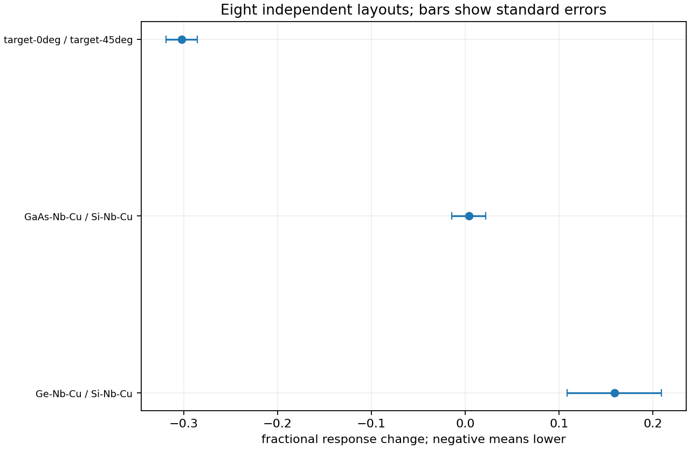
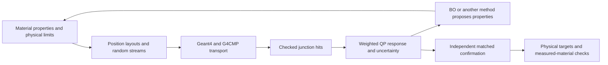

# Material properties and phonon-induced quasiparticles

This project uses numerical optimization to find substrate and film properties
that reduce phonon-induced quasiparticles in quantum-device junction regions.
Geant4/G4CMP calculates transport; every optimization response comes from a
completed simulation. The present result is a **physical-property target**,
not an identified new material or a measured reduction in qubit error.


The illustration shows the goal: redirect or absorb substrate phonons before
they create quasiparticles near junctions. Paths and layer spacing are illustrative.
The reference model has a 525 μm Si substrate, 75 nm Nb upper film, 1 μm Cu
bottom film, and seventeen 10 × 10 μm² Al collection regions of thickness 120 nm.
The current studies use **20 mK**, **10 meV** injected phonons, and an upper-film
gap of at least **1.5384 meV**.

## Response and spatial sampling

Let $x\in\mathcal X$ denote material properties, $\xi$ a uniformly distributed
source position on the declared 8 × 8 mm² region, $\omega$ a transport realization,
and $e$ a junction. With $Q_e$ quasiparticles per injected phonon and source
energy $E_g$ in eV, the minimized response is

$$
J(x)=\mathbb E_{\xi,\omega}\!\left[
\frac{\sum_e w_e Q_e(x,\xi,\omega)}{E_g}\right],
\qquad w_e\geq0,\quad\sum_e w_e=1.
$$

The units are **weighted junction QPs per injected eV**. A recorded junction hit
with deposited energy $E_k$ contributes
$q_k=\operatorname{round}(E_k/\Delta_{\rm Al})$, with
$\Delta_{\rm Al}=191\,\mu\mathrm{eV}$. Only junction hits enter this response.
The separate `total_qps_per_primary` response sums junctions without energy
normalization; its numerical values cannot be compared directly with $J$.


Positions near junctions are deliberately sampled more densely. For source
region $h$, let $W_h$ be its area fraction, $n_h$ its sampled positions,
$R$ the transport realizations, and $N_{ire}$ the QPs from $N_p$ primaries at
position $i$, realization $r$, and junction $e$. The estimator is

$$
\widehat J=
\sum_h\frac{W_h}{n_h}\sum_{i\in h}\frac{1}{R}
\sum_{r=1}^{R}\frac{\sum_e w_eN_{ire}}{N_pE_g}.
$$

An unweighted average over these positions gives the wrong spatial integral.
Transport error at fixed positions and variation between independent position
layouts are reported separately. Failed, missing or incomplete measurements
remain absent. A witnessed, complete header-only hit file can represent zero.

## Confirmed optimization results

The current nine-method comparison finished on **2026-10-21**:
**70 complete studies**, **118.336 billion primaries in complete measurements**,
and **26 distinct selected designs confirmed on four unused layouts**.
The October 19 restart added 96.576 billion primaries, retaining 23 verified CPU
studies, and finished in 54.6 hours. Every study has two verified archive copies.
The [search inputs](studies/optimization/queue_restart.yaml),
[additional physical comparisons](studies/optimization/refinement.yaml),
[complete results](docs/results/optimization_summary.json), and
[verification](verification/optimization_restart_20261019.json) retain provenance.

Each of three search seeds shared **24 measured starting points** across all
methods, followed by **32 new responses per method**. Screening used 512
positions, four realizations and 31,250 primaries per task. Confirmation used
four unused layouts, each with 1,024 positions, eight realizations and 62,500
primaries per task. Selected designs shared confirmation positions and streams.
Confirmation data were excluded from search and model prompts.

The six search coordinates are $C_{11},C_{12},C_{44}$ in GPa, upper-film gap
$\Delta_t$ in eV, and film lifetimes $\tau_t,\tau_b$ in ns.
The map $u\in[0,1]^6\mapsto x\in\mathcal X$ is linear for elastic constants and
logarithmic for gap and lifetimes. Bounds are $[20,450]$, $[0,250]$, $[5,250]$
GPa, $[1.5384,3.5]$ meV, $[0.001,1]$ ns and $[0.5,50]$ ns, respectively.
Cubic elastic stability is required. Other properties remain fixed to the
recorded calibrated background.

Let $g=1-J(x_{\rm selected})/J(x_{\rm initial})$ be added improvement relative to
that seed's shared starting winner. The table averages confirmed results over
the three search seeds; calibration gains are excluded from $g$.

| Method | Mean confirmed $J$ [QP/eV] | Added reduction $g$ |
|---|---:|---:|
| Random | 0.000570905 | 0% |
| Sobol | 0.000570905 | 0% |
| CMA-ES | 0.000425301 | 25.5% |
| BO: Gaussian-process expected improvement | 0.000410339 | 28.1% |
| Improved BO: local range and predicted-time weighting | 0.000402924 | **29.4%** |
| BO with transport-error checks and distinct proposals | 0.000407383 | 28.6% |
| Corners and coordinate refinement | 0.000404828 | 29.1% |
| LLM proposals + improved BO | 0.000447069 | 21.7% |
| LLM checks + improved BO | 0.000438348 | 23.2% |


The figure shows standard errors across three search seeds, conditional on the
four measured layouts. Paired layout intervals are retained separately.
**BO contributed approximately 28–29% beyond the shared starting design.**
The 95% interval for ordinary BO's added gain across these seeds is 26.3–30.0%.
Improved BO's response was only 1.8% below ordinary BO; that difference remains
unresolved. The BO variant accounting for transport error reached a similar
response in 0.94 h per search, compared with 1.27 h for ordinary BO. These times
include the 32 new responses and depend on the physical points selected.
Random and Sobol retained the starting winner in every seed; this does not
imply zero physical response or a general failure of those methods.

Qwen3.8-27B inference worked: the six main AI searches made 116 model calls,
accepted 344 proposals and measured 14 LLM-origin points out of 192 new responses.
None of their selected leaders originated from the LLM. Indirect effects through
the fitted GP remain possible, but **no added AI improvement was demonstrated**.
More inference or larger models are not justified by these results alone.

## Physical findings and remaining limits

The matched 0°/45° experiment below confirms a **30.22% reduction** for the
specified property target, with an adjusted interval of **25.04–35.41% reduction**.
Every one of its eight layouts favored 0°. Mean $J$ changed from 0.000409613 to
0.000285456. About 92% of the estimated change came from the outer two source
regions, consistent with rotation changing phonon propagation relative to junctions.

The target has $(C_{11},C_{12},C_{44})=(450,0,5)$ GPa, upper-film lifetime
1 ps, lower-film lifetime 0.5 ns and gap 1.5384 meV. Its other inputs remain the
calibrated background, including film densities of 15,010.9 and 7,184.4 kg/m³.
Elastic stability does not establish that this combined property set exists.

For native substrates at 45°, Ge–Nb–Cu gave a higher response than Si–Nb–Cu in
all eight layouts. The mean paired relative increase was 15.89%, with a broad
adjusted interval of 0.12–31.65%; the absolute-difference interval includes zero.
GaAs differed by 0.38%, with interval −5.22% to +5.98%, establishing neither an
improvement nor equivalence within 5%. Position variation near junctions dominates
these remaining uncertainties. The relative intervals average layout-specific
ratios; they are not intervals for a ratio of pooled means.

The earlier primary-count check passed at fixed positions, while spatial
convergence remains unresolved. Further studies retain each native material's
density, lattice, elastic constants and phonon rates. Film lifetimes and
interfaces still contain model assumptions. Junction-QP yield alone does not
establish a fabrication optimum, global minimum or qubit-error reduction.

<!-- focused-start -->
## Matched rotation and native-material comparison

Finished 2026-10-27. Eight unused 1,024-position layouts compare 0° with 45° at identical properties, and Ge/Nb/Cu and GaAs/Nb/Cu with Si/Nb/Cu.

| Candidate / reference | Response change | Simultaneous interval | At least 5% reduction established |
|---|---:|---:|---|
| target-0deg / target-45deg | -30.22% | [-35.41%, -25.04%] | True |
| Ge-Nb-Cu / Si-Nb-Cu | +15.89% | [+0.12%, +31.65%] | False |
| GaAs-Nb-Cu / Si-Nb-Cu | +0.38% | [-5.22%, +5.98%] | False |



[Paired intervals, physical inputs and limits](docs/results/orientation_materials.md).
<!-- focused-end -->

<!-- native-start -->
## Native-material orientation study: October 28

The [new study](studies/native/queue.yaml) applies the measured sampling results
before further optimization. Its three parts use a single evaluator and stay
within **1,024 source positions**:

1. Compare native Si, Ge and GaAs with Nb/Cu at 0° and 45° on eight new layouts.
2. For each substrate and three search seeds, give BO and Sobol the same twelve
   measured starts and sixteen additional responses per method. Vary only crystal
   orientation; native density, elasticity, phonon rates and film inputs stay fixed.
3. Confirm the starting winners, optimizer leaders and fixed 0°/45° controls on
   four unused layouts. Confirmation observations stay out of search and selection.

The orientation variables are $c\in[-1,1]$, $a\in[0,1]$ and
$\phi\in[0,359]$ degrees. The surface normal in crystal coordinates is

$$
n(c,a)=\left(\sqrt{1-c^2}\cos(2\pi a),\sqrt{1-c^2}\sin(2\pi a),c\right).
$$

Here $\phi$ is rotation about that normal. The upper limit avoids repeating the
360° endpoint and approximates the full in-plane range to one degree.
The GP uses a spherical distance for the normal. The twelve starts comprise
(001), (110) and (111) normals at 0°/45°, plus six seeded Sobol orientations.
Three optimizer seeds support an exploratory comparison, not a global-minimum claim.

The region area fractions remain unchanged. Counts change as follows:

| Source region | Previous 1,024 | New 1,024 | Search 512 |
|---|---:|---:|---:|
| Junction rectangles | 136 | 34 | 17 |
| Within 0.05 mm | 128 | 512 | 256 |
| 0.05–0.20 mm | 256 | 102 | 51 |
| 0.20–0.50 mm | 256 | 170 | 85 |
| Remaining source area | 248 | 206 | 103 |

The allocation was fixed from the previous eight layouts. A regional variance
approximation predicts approximately half the position error for Ge/GaAs.
New orientations can change that estimate. Each position uses four realizations, with
31,250 primaries per task: fewer primaries increase conditional transport
error, which remains measured separately. A balanced half-layout comparison
uses the first half of positions within each region, chosen before examining
new responses. It diagnoses 512/1,024 agreement without extra transport and does
not establish convergence throughout the orientation domain.

| Resource | Allocation or estimate |
|---|---|
| Studies | 39 sequential stages |
| Complete primary counts | At most **48.384 billion**, before confirmation deduplication and failed attempts |
| Workers | **86**, inside the 96-CPU total limit; eight CPUs remain reserved for the model service |
| GPUs | **0** |
| Host memory | **64 GiB** combined limit, 2 GiB per task, 16 GiB host reserve |
| Additional working storage | Approximately **35–55 GiB**, plus a 20 GiB free-disk reserve |
| Elapsed time | **36–60 h after launch**, depending on orientation-dependent transport and archive checks |

The run is `native_orientation_20261028_full`, launched on **October 28**.
Expected completion is **October 30–31 EDT**, conditional on uninterrupted execution.
[Launch verification](verification/native_orientation_launch_20261028.json) records
source hashes, fresh layouts, physical identities, tests and execution checks.
Expected outcomes include a native
rotation response, measured precision after reallocation, and BO's added gain
against the same starting data and Sobol. A 30% gain in the calibrated target
does not predict the gain in Si, Ge or GaAs. BO may add little beyond the starting
orientations; all outcomes and incomplete searches remain visible.

```bash
bash run_all.sh status material_scan_data/native_orientation_20261028_full
tmux -L material-scan attach -t native_orientation_20261028_full
```
<!-- native-end -->

## Are 2,048 positions worthwhile?

**A small confirmation check can be worthwhile; a full search at 2,048 positions
is premature.** At unchanged primaries per position, doubling positions roughly
doubles transport and may reduce position error by $1/\sqrt2\simeq0.707$.
Reallocating 1,024 positions is predicted to improve Ge/GaAs precision more
strongly than uniformly doubling the previous allocation.

A more efficient diagnostic holds total primary count fixed: use 2,048 positions
with 15,625 primaries per task instead of 1,024 with 31,250, retaining four
realizations. Position error may fall by 29%, while transport error is approximately
unchanged. Saved task times suggest **25–50% more elapsed time**, owing to extra
process and file overhead, rather than twice the primary work. Four layouts of
the six native 0°/45° cases would require **3.072 billion new primaries** and
approximately **3–6 hours**, compared against the retained 1,024-site results.
This estimate depends on retaining comparable physical inputs and source streams.

The [allocation and cost analysis](verification/site_allocation_20261028.json)
records the equations, measured task times and assumptions. A 2,048-site diagnostic
is most useful if balanced-half shifts or finalist position errors still affect
the new conclusions. The active queue retains the existing **1,024-site limit**.

## Calculation and execution



The maintained code consists of **ten scripts**:

| File | Calculation |
|---|---|
| [`scan.py`](scan.py) | Study inputs, physical candidates, simulation tasks and commands |
| [`physics.py`](physics.py) | Physical maps, validity, elasticity, positions, hit scoring and QPs |
| [`analysis.py`](analysis.py) | Weighted responses, uncertainty and matched comparisons |
| [`search.py`](search.py) | Optimizers, Gaussian processes and bounded Ollama interaction |
| [`records.py`](records.py) | Inputs, hits, SQLite results, archives and recovery |
| [`run_all.sh`](run_all.sh) | Sequential studies, resource checks, preservation and reporting |
| [`figures/plot.py`](figures/plot.py) | Measured-result plots and surface-hit counts |
| [`figures/draw.py`](figures/draw.py) | Device, sampling and workflow drawings |
| [`tests/test_physics.py`](tests/test_physics.py) | Physical and numerical tests |
| [`tests/test_workflow.py`](tests/test_workflow.py) | Execution, optimization, records and plotting tests |

Use the existing `G4CMP` environment. External Geant4/G4CMP paths are supplied
by the study's `installation` record. The small reference example checks software;
it is not a spatial-convergence study.

```bash
conda run -n G4CMP python scan.py check studies/reference-eight.yaml
conda run -n G4CMP python scan.py run studies/reference-eight.yaml \
  --output material_scan_data/experiments/reference-eight
conda run -n G4CMP python -m unittest discover -s tests -v

# Native orientation study; prepare freezes source, executable and inputs.
MATERIAL_QUEUE_CONFIG=studies/native/queue.yaml \
  bash run_all.sh prepare material_scan_data/native_orientation_20261028_full
bash run_all.sh run material_scan_data/native_orientation_20261028_full
```

Repeating a run with unchanged inputs resumes recorded work. New physical inputs
require a new directory. Results stay under ignored `material_scan_data/`;
figures and figure inputs stay in `figures/`. Completed data are preserved in two
verified archives on separate filesystems. Use `python scan.py COMMAND --help`
for analysis, comparison, plotting, archive verification and recovery commands.

## Surface-hit records


This histogram counts boundary-hit rows per file, not unique injected phonons
or junction QPs. It uses all **4,096 completed reference files** from the
500,000-primary study: **10,050,999 surface-hit records**, median 213 per file,
range 12–18,762. Bins are uniform in $\log(1+H_f)$, where $H_f$ is the row count
for file $f$; axis labels show raw counts. Near-junction oversampling remains
visible in the file distribution and is not an area-weighted physical result.
[Per-file counts](figures/surface_hits_events500000_reference.csv) and
[checksums and reproduction command](figures/surface_hits_events500000_reference.json)
retain provenance.

```bash
conda run -n G4CMP python figures/plot.py hits STUDY_DIRECTORY \
  --output figures/hits.png --counts figures/hits.csv
```
