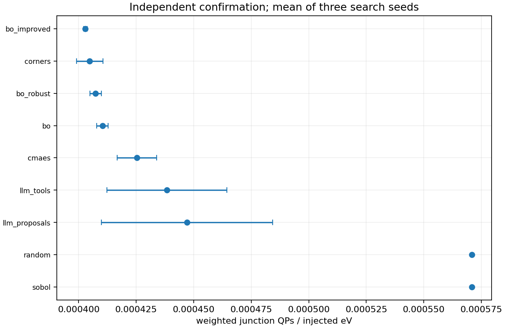
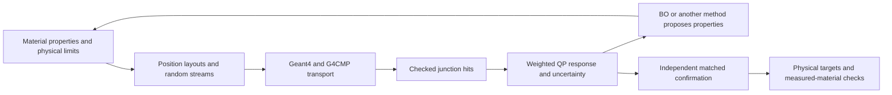

# Material properties and phonon-induced quasiparticles

This project uses numerical optimization to find substrate and film properties
that reduce phonon-induced quasiparticles in quantum-device junction regions.
Geant4/G4CMP calculates transport; every optimization response comes from a
completed simulation. The present result is a **physical-property target**,
not an identified new material or a measured reduction in qubit error.


The illustration shows the goal: redirect or absorb substrate phonons before
they create quasiparticles near junctions. Paths and layer spacing are illustrative.
The reference model has a 525 μm Si substrate, 75 nm Nb upper film, 1 μm Cu
bottom film, and seventeen 10 × 10 μm² Al collection regions of thickness 120 nm.
The current studies use **20 mK**, **10 meV** injected phonons, and an upper-film
gap of at least **1.5384 meV**.

## Response and spatial sampling

Let $x\in\mathcal X$ denote material properties, $\xi$ a uniformly distributed
source position on the declared 8 × 8 mm² region, $\omega$ a transport realization,
and $e$ a junction. With $Q_e$ quasiparticles per injected phonon and source
energy $E_g$ in eV, the minimized response is

$$
J(x)=\mathbb E_{\xi,\omega}\!\left[
\frac{\sum_e w_e Q_e(x,\xi,\omega)}{E_g}\right],
\qquad w_e\geq0,\quad\sum_e w_e=1.
$$

The units are **weighted junction QPs per injected eV**. A recorded junction hit
with deposited energy $E_k$ contributes
$q_k=\operatorname{round}(E_k/\Delta_{\rm Al})$, with
$\Delta_{\rm Al}=191\,\mu\mathrm{eV}$. Only junction hits enter this response.
The separate `total_qps_per_primary` response sums junctions without energy
normalization; its numerical values cannot be compared directly with $J$.


Positions near junctions are deliberately sampled more densely. For source
region $h$, let $W_h$ be its area fraction, $n_h$ its sampled positions,
$R$ the transport realizations, and $N_{ire}$ the QPs from $N_p$ primaries at
position $i$, realization $r$, and junction $e$. The estimator is

$$
\widehat J=
\sum_h\frac{W_h}{n_h}\sum_{i\in h}\frac{1}{R}
\sum_{r=1}^{R}\frac{\sum_e w_eN_{ire}}{N_pE_g}.
$$

An unweighted average over these positions gives the wrong spatial integral.
Transport error at fixed positions and variation between independent position
layouts are reported separately. Failed, missing or incomplete measurements
remain absent. A witnessed, complete header-only hit file can represent zero.

## Confirmed optimization results

The current nine-method comparison finished on **2026-10-21**:
**70 complete studies**, **118.336 billion primaries in complete measurements**,
and **26 distinct selected designs confirmed on four unused layouts**.
The October 19 restart added 96.576 billion primaries, retaining 23 verified CPU
studies, and finished in 54.6 hours. Every study has two verified archive copies.
The [search inputs](studies/optimization/queue_restart.yaml),
[additional physical comparisons](studies/optimization/refinement.yaml),
[complete results](docs/results/optimization_summary.json), and
[verification](verification/optimization_restart_20261019.json) retain provenance.

Each of three search seeds shared **24 measured starting points** across all
methods, followed by **32 new responses per method**. Screening used 512
positions, four realizations and 31,250 primaries per task. Confirmation used
four unused layouts, each with 1,024 positions, eight realizations and 62,500
primaries per task. Selected designs shared confirmation positions and streams.
Confirmation data were excluded from search and model prompts.

The six search coordinates are $C_{11},C_{12},C_{44}$ in GPa, upper-film gap
$\Delta_t$ in eV, and film lifetimes $\tau_t,\tau_b$ in ns.
The map $u\in[0,1]^6\mapsto x\in\mathcal X$ is linear for elastic constants and
logarithmic for gap and lifetimes. Bounds are $[20,450]$, $[0,250]$, $[5,250]$
GPa, $[1.5384,3.5]$ meV, $[0.001,1]$ ns and $[0.5,50]$ ns, respectively.
Cubic elastic stability is required. Other properties remain fixed to the
recorded calibrated background.

Let $g=1-J(x_{\rm selected})/J(x_{\rm initial})$ be added improvement relative to
that seed's shared starting winner. The table averages confirmed results over
the three search seeds; calibration gains are excluded from $g$.

| Method | Mean confirmed $J$ [QP/eV] | Added reduction $g$ |
|---|---:|---:|
| Random | 0.000570905 | 0% |
| Sobol | 0.000570905 | 0% |
| CMA-ES | 0.000425301 | 25.5% |
| BO: Gaussian-process expected improvement | 0.000410339 | 28.1% |
| Improved BO: local range and predicted-time weighting | 0.000402924 | **29.4%** |
| BO with transport-error checks and distinct proposals | 0.000407383 | 28.6% |
| Corners and coordinate refinement | 0.000404828 | 29.1% |
| LLM proposals + improved BO | 0.000447069 | 21.7% |
| LLM checks + improved BO | 0.000438348 | 23.2% |



The figure shows standard errors across three search seeds, conditional on the
four measured layouts. Paired layout intervals are retained separately.
**BO contributed approximately 28–29% beyond the shared starting design.**
The 95% interval for ordinary BO's added gain across these seeds is 26.3–30.0%.
Improved BO's response was only 1.8% below ordinary BO; that difference remains
unresolved. The BO variant accounting for transport error reached a similar
response in 0.94 h per search, compared with 1.27 h for ordinary BO. These times
include the 32 new responses and depend on the physical points selected.
Random and Sobol retained the starting winner in every seed; this does not
imply zero physical response or a general failure of those methods.

Qwen3.8-27B inference worked: the six main AI searches made 116 model calls,
accepted 344 proposals and measured 14 LLM-origin points out of 192 new responses.
None of their selected leaders originated from the LLM. Indirect effects through
the fitted GP remain possible, but **no added AI improvement was demonstrated**.
More inference or larger models are not justified by these results alone.

## Physical findings and remaining limits

The strongest controlled screening change was **in-plane crystal rotation from
45° to 0°**, reducing $J$ by 35.2% at otherwise identical properties. Its selected
0° target independently confirmed at
$J=0.000300141$, with a four-layout 95% interval
$[0.000286310,0.000313972]$. This is 25.5% below the best BO method's mean,
but that comparison changes more than rotation. A direct matched rotation
confirmation is the next measurement.

The target has $(C_{11},C_{12},C_{44})=(450,0,5)$ GPa, upper-film lifetime
1 ps, lower-film lifetime 0.5 ns and gap 1.5384 meV. Its other substrate and film
inputs remain the calibrated background. Elastic stability does not establish
that this combined property set exists in a material.
For example, its upper- and lower-film densities are 15,010.9 and 7,184.4 kg/m³;
these are calibrated property inputs rather than the native Nb/Cu pair.

For native materials, Ge–Nb–Cu appeared 11.3% below Si–Nb–Cu during screening.
In independent confirmation, Ge–Nb–Cu instead gave $J=0.00242081$, compared
with $0.00231736$ for Si–Nb–Cu: approximately 4.5% higher. Its apparent advantage
did not survive confirmation. Physical inputs were identical between phases;
source-position and transport variation remain important. Only the selected
native winner was confirmed, so the complete native ranking is unresolved.

The earlier primary-count test passed at fixed positions, while the spatial
convergence test failed. Four additional layouts do not establish convergence
throughout the search domain. All further layouts remain at **1,024 positions
or fewer**. Materials retain their own density and lattice records; scattering,
film lifetimes and interface assumptions require independent physical support.
Junction-QP yield alone does not establish a fabrication optimum, global
minimum or qubit-error reduction.

<!-- focused-start -->
## Next measurement: matched rotation and native materials

The [fixed follow-up inputs](studies/focused/queue.yaml) define **five designs**:
the same property target at 0° and 45°, and native Si–Nb–Cu, Ge–Nb–Cu and
GaAs–Nb–Cu. The native cases retain their own coupled substrate records and the
reference film model. They are not assigned the calibrated target's film inputs.

All five designs use **eight new, independent 1,024-position layouts**. Each
layout has eight transport realizations and 62,500 primaries per task. Positions,
area fractions and streams are matched across candidates within a layout.
The three comparisons are fixed before transport: 0° against 45°, Ge against Si,
and GaAs against Si. No candidate is selected using these observations.

For comparison $a/b$ and layout $k$, the observations are
$d_k=\widehat J_{a,k}-\widehat J_{b,k}$ and
$r_k=\widehat J_{a,k}/\widehat J_{b,k}-1$. Intervals describe their means over
eight layouts; the mean of ratios generally differs from the ratio of means.
Student-t intervals use a Bonferroni correction
across the three comparisons: each interval has confidence 98.33%, giving
family error at most 5% under the stated assumptions. A useful reduction requires
the entire relative-change interval below −5%. All outcomes are retained;
the calculation completes all eight layouts without early stopping.

| Quantity | Allocation or estimate |
|---|---|
| Transport | **20.48 billion primaries; 327,680 tasks** |
| CPUs | **86 workers**, inside the 96-CPU total limit; eight CPUs reserved for the model service |
| GPUs | **0**; no new LLM inference |
| Host memory | Combined limit **64 GiB**; 2 GiB per task; 16 GiB host reserve |
| Additional working storage | Approximately **20–30 GiB**, plus a 20 GiB free-disk reserve |
| Independent archive storage | Approximately **8–12 GiB**, plus the free-disk reserve |
| CPU time | Approximately **1,100 CPU-hours** at the measured task rates |
| Elapsed time | **14–20 h after launch**; allow up to 24 h for archive checks and variable load |

These are measured-rate estimates, not guaranteed completion times. The 0°
effect may remain substantial, but its screening estimate can overstate the
confirmed gain. Ge or GaAs may fail to improve on Si. At equal variance, eight
layouts reduce mean standard error by approximately $\sqrt{4/8}=0.707$ relative
to four; the correction for three comparisons widens the intervals. Small effects
may remain unresolved. This experiment does not certify spatial convergence.

The run is `orientation_materials_20261026`, launched on **October 26**.
[Launch verification](verification/orientation_materials_launch_20261026.json)
records fresh layout hashes, matching physical inputs, execution checks and timing assumptions.
The expected finish is **October 27 EDT**, conditional on uninterrupted execution.
Check its recorded state with
`bash run_all.sh status material_scan_data/orientation_materials_20261026`.
A persistent tmux session of the same name runs the eight layouts sequentially.
Two verified archives preserve each completed layout before raw working files
are removed. Completion generates the paired comparisons and updates this section.
<!-- focused-end -->

The subsequent optimization should include crystal orientation and physically
coupled material choices, retaining BO and corner refinement as controls.
Additional optimizer seeds can then test smaller differences. A bounded LLM
should propose physical hypotheses or checks; any claimed benefit must be an
added, independently confirmed reduction under equal measured work.

## Calculation and execution



The maintained code consists of **ten scripts**:

| File | Calculation |
|---|---|
| [`scan.py`](scan.py) | Study inputs, physical candidates, simulation tasks and commands |
| [`physics.py`](physics.py) | Physical maps, validity, elasticity, positions, hit scoring and QPs |
| [`analysis.py`](analysis.py) | Weighted responses, uncertainty and matched comparisons |
| [`search.py`](search.py) | Optimizers, Gaussian processes and bounded Ollama interaction |
| [`records.py`](records.py) | Inputs, hits, SQLite results, archives and recovery |
| [`run_all.sh`](run_all.sh) | Sequential studies, resource checks, preservation and reporting |
| [`figures/plot.py`](figures/plot.py) | Measured-result plots and surface-hit counts |
| [`figures/draw.py`](figures/draw.py) | Device, sampling and workflow drawings |
| [`tests/test_physics.py`](tests/test_physics.py) | Physical and numerical tests |
| [`tests/test_workflow.py`](tests/test_workflow.py) | Execution, optimization, records and plotting tests |

Use the existing `G4CMP` environment. External Geant4/G4CMP paths are supplied
by the study's `installation` record. The small reference example checks software;
it is not a spatial-convergence study.

```bash
conda run -n G4CMP python scan.py check studies/reference-eight.yaml
conda run -n G4CMP python scan.py run studies/reference-eight.yaml \
  --output material_scan_data/experiments/reference-eight
conda run -n G4CMP python -m unittest discover -s tests -v

# Full follow-up; prepare freezes source, executable, libraries and inputs.
MATERIAL_QUEUE_CONFIG=studies/focused/queue.yaml \
  bash run_all.sh prepare material_scan_data/orientation_materials_20261026
bash run_all.sh run material_scan_data/orientation_materials_20261026
```

Repeating a run with unchanged inputs resumes recorded work. New physical inputs
require a new directory. Results stay under ignored `material_scan_data/`;
figures and figure inputs stay in `figures/`. Completed data are preserved in two
verified archives on separate filesystems. Use `python scan.py COMMAND --help`
for analysis, comparison, plotting, archive verification and recovery commands.

## Surface-hit records


This histogram counts boundary-hit rows per file, not unique injected phonons
or junction QPs. It uses all **4,096 completed reference files** from the
500,000-primary study: **10,050,999 surface-hit records**, median 213 per file,
range 12–18,762. Bins are uniform in $\log(1+H_f)$, where $H_f$ is the row count
for file $f$; axis labels show raw counts. Near-junction oversampling remains
visible in the file distribution and is not an area-weighted physical result.
[Per-file counts](figures/surface_hits_events500000_reference.csv) and
[checksums and reproduction command](figures/surface_hits_events500000_reference.json)
retain provenance.

```bash
conda run -n G4CMP python figures/plot.py hits STUDY_DIRECTORY \
  --output figures/hits.png --counts figures/hits.csv
```
