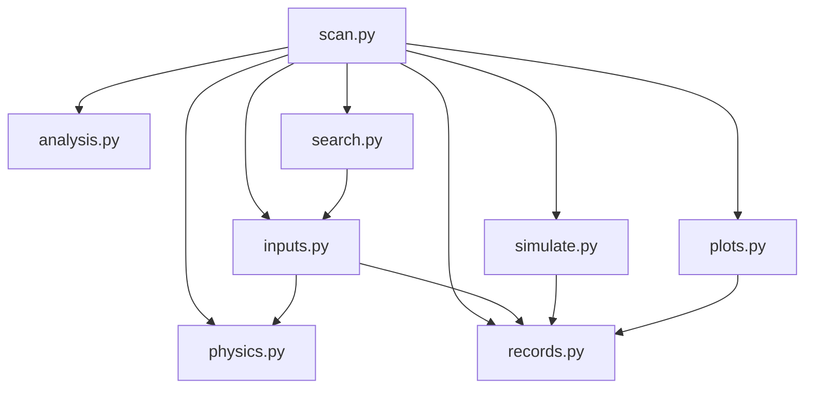

# Material optimization in 10 Python files

Reviewed 2026-10-14. Source revision: `c8cdb996209711bef0e266c7315bfa518eda47e8`.
New branch: `Material_optimization_v3_scan_parameters_further_revised`, created
from `Material_optimization_v3_scan_parameters_revised` at that revision.

**Use eight working scripts and two test scripts, all in one directory.** Keep
one implementation of each physical calculation, one simulation loop, one
result writer, and one plotting path. Replace shell sequences with study
definitions in YAML. Put equations and explanations in the scientific notes;
leave only units, array dimensions, and necessary numerical details in code.

This document preserves the original analysis and proposed implementation.
The eight working scripts and two test scripts are now implemented; measured
comparisons and remaining scientific work are in
[`WORKFLOW_VERIFICATION.md`](WORKFLOW_VERIFICATION.md). Historical raw data and
databases are preserved. Superseded source is available at the revision above.

## 1. What the project actually contains

The scientific work has five parts: Morris sensitivity analysis, linked
real-material comparisons, continuous-property optimization, spatial and
statistical convergence, and projection onto measured material properties.
Confirmation, tolerance studies, hit diagnostics, result preservation, and
figures support those calculations. All belong in the proposed implementation.

I read all 18 existing Markdown files, including ignored local reports, and
parsed every Python file. I inspected imports inside functions, class
inheritance, function calls, command dispatch, shell commands, embedded Python,
and the notebook cells. Appendices A–C identify every source file and document.

| Present source | Files | Lines | Functions and methods | Classes |
|---|---:|---:|---:|---:|
| `material_scan`, excluding tests | 17 | 5,865 | 212 | 47 |
| `legacy`, excluding tests and notebook | 36 | 16,150 | 449 | 31 |
| Presentation generator | 1 | 551 | 21 | 0 |
| Tests | 7 | 4,157 | 144 | 16 |
| Bash | 11 | 1,113 | — | — |
| Historical notebook | 1 | 1,139 code lines | — | — |

There are **73 source files**, including tests and the notebook. The 54
non-test Python files contain **682 functions/methods and 78 classes**. These
counts describe source present, not 54 simultaneously used programs. The
retired shell file and historical notebook are explicitly distinguished below.
Nested functions and special methods are included; blank lines are included
in file lengths. Function counts alone do not measure execution time.

The current package's 47 classes comprise 24 data records, 19 exception classes,
and four other classes: `Store`, `HistoricalDatabase`, `GitTree`, and
`SearchController`. Most of the class count therefore comes from representing
and moving records, rather than numerical algorithms.

## 2. Calls, repeated work, and incomplete connections

### Two implementations coexist

The current command path is:

```text
material-scan / python -m material_scan
  cli.main -> selected command
    check/freeze -> config -> sampling + identity
    inventory/history -> historical
    archive/recover -> archive
    store-doctor -> store
    run -> raises ConfigError
```

`material_scan/runner.py`, `physics.py`, `analysis.py`, and `search.py` are
imported only by tests within the repository. Their numerical and execution
parts are not connected to the current command's simulation path. This is
unfinished integration, not evidence that those files should be discarded.

The retained simulation path is:

```text
stage4_optimize / stage4_confirm / stage4_pilot / stage4_tolerance
  -> stage4_optimize.build_space + resolver_for
  -> stage3_trial_runner.evaluate
       -> stage4_space.resolve -> derive
            -> stage1_run_simulations.derive_cubic_sound_speeds
            -> interface_transmission.resolve_all_interfaces
       -> _write_lattice_config + _write_sub_run_macro
       -> _run_one -> stage1_run_simulations.build_run_command -> Geant4
       -> _score -> _score_one -> stage2_compute_QPs.calculate_QPs
  -> stage4_objectives -> stored observation -> optimizer update
```

Separately, `SearchController` inserts `legacy` into `sys.path`, imports
`stage4_optimizers`, and delegates proposals and updates. That module imports
`stage4_space`, which imports the 1,810-line Morris runner for physical helpers.
Importing the runner also loads SALib, reads many environment settings, and
constructs its angular sampling array. A sound-speed calculation should not
depend on a simulation driver or Morris sampling software.

The graph has little deep inheritance. Its main problems are duplicated
definitions, several representations of the same inputs, scattered execution
control, and dependencies pointing from physics back into drivers.

### Specific reductions

| Evidence in current source | Consequence | Proposed change |
|---|---|---|
| `legacy/stage2_compute_QPs.py:31` and `stage2_compute_QPs_sensitivity_analysis.py:93` have identical QP bodies; `material_scan/physics.py:89` implements the vector form | Three maintained scorers, plus notebook copies | One array calculation in `physics.py` |
| The two retained `calculate_xQPs` bodies are identical; the current package has another checked implementation | Three density calculations | One optional density calculation in `physics.py` |
| `config.py` and `sampling.py` have identical `_freeze` and `_thaw` bodies; multiple `to_manifest` methods repeatedly reconstruct records | Extra object conversions and duplicated validation | One normalized input record and one recorded task table |
| Canonical JSON/hash functions appear in `identity.py`, `store.py`, `search.py`, and retained files | Several serialization rules to understand | One new serializer in `records.py`; preserve older hash formats only when reading old records |
| Identical directory-sync functions occur in `archive.py`, `historical.py`, and `runner.py`; archive/history also duplicate a file-hash body | Repeated file utilities | One shared implementation in `records.py` |
| `stage4_objectives.py:488` holds a global spatial design; the current analysis takes it explicitly | A result can depend on previously installed global state | Pass the recorded design directly to analysis |
| `stage3_trial_runner.evaluate` is 337 lines; its `_run_one` is 230 lines | Planning, subprocess control, SQL, recovery, and scoring are interleaved | A short coordinating calculation plus one process runner and one result writer |
| Candidate threads each create task threads and a memory guard | Nested scheduling and divided worker slots; several SQLite connections write | One queue of simulation tasks, one global worker limit, one writer |
| `stage4_strata.stratum_weights` allocates arrays for 8,000,000 positions against every electrode | A single float64 position-by-electrode array is about 1.09 GB for 17 electrodes; several arrays coexist | Generate area estimates in chunks once per new geometry; load recorded weights thereafter |
| `analysis._hierarchical_standard_error` and `paired_stratified_difference` rebuild each region's array inside every resampling draw | Repeated conversion of unchanged data | Prepare region arrays once and share one resampling calculation |
| `GaussianProcess._nll`, `fit`, `predict`, `reset_data`, and `add_fantasy` use general `np.linalg.solve` on Cholesky factors | The solver does not use the known triangular structure | Use triangular/Cholesky solves; check likelihood, gradients, predictions, and proposals against the reference |
| Every retained `_score_one` creates a DataFrame and a 17 × 1,001 time matrix, then keeps only electrode totals | Unnecessary allocations when optimizing a total yield | Read selected columns in chunks; accumulate electrode totals directly; request time bins only for time-dependent analysis |
| `stage1_run_simulations.build_run_command` produces a shell command that sources the installation for every task | Repeated shell startup and environment setup | Resolve the installation environment once; launch the executable with an argument list |
| SVG/HTML plots in `tools/hit_data.py` overlap Matplotlib plots in `tools/plot_hits.py` | Two plotting implementations and repeated styling | One Matplotlib path, exporting PNG/PDF/SVG |
| Report, projection, confirmation, and shell files each implement study-specific loops | Many entry points for nearly the same evaluation | One evaluator; candidate tables and study settings select the calculation |

The new runner also needs deliberate reconciliation with the retained one:
`material_scan.runner.run_task` rejects every nonzero exit, while the retained
runner distinguishes an exit-time segmentation fault after witnessed completion.
The retained evaluator wraps task timeouts in `incomplete_scenario_set`, while
the optimizer's special timeout branch tests for `STATUS_TIMEOUT`. That branch
does not receive those wrapped timeouts. Preserve the reason for stopping as
structured data, and keep an unmeasured yield absent.

Retain the existing strengths: vectorized hit calculations, cached cubic sound
speeds, complete task-set checks, paired spatial comparisons, and separate
simulation/analysis/search hashes. Consolidation should connect these checked
calculations rather than introduce another numerical implementation.

### Paths and function usage

Most Bash drivers change into `legacy/scripts` and then invoke sibling Python
filenames that now live in `legacy`. For example,
`run_stage4_optimizer_benchmark.sh` invokes a nonexistent
`legacy/scripts/stage4_optimize.py`. `run_2stage_1e5.sh` still invokes the removed
root-level runner and macro. The presentation generator similarly looks for
`data/stage3_config.yaml`, although the file is in `legacy`. These are confirmed
path mismatches; shell syntax checking does not detect them.

There are 36 single-statement functions/methods in the current package and 44
in retained Python source. Some, such as context-manager methods, are useful.
Inline accessors and forwarding functions only when they add no validation,
calculation, repeated use, or useful physical name. A standalone command with
no Python importer is not automatically unused. Appendices A and B include
those entry points and shell-only calls.

### Small timing checks

Measured in the existing G4CMP environment: Python 3.12.13, NumPy 2.4.6,
Pandas 3.0.3. These measure isolated calculations, excluding CSV reading and
Geant4. They are not whole-project speed estimates.

| Calculation | Existing calculation | Reduced work | Ratio | Comparison |
|---|---:|---:|---:|---|
| 20,000 synthetic surface hits, 17 electrodes, 1,001 time bins | Retained per-hit loop: 2.314 s | Existing vector calculation: 0.00869 s | 266× | Identical QP arrays |
| 2,361 sites, 8 realizations, 1,000 resampling draws | Rebuild region arrays: 1.845 s | Prepare arrays once: 0.827 s | 2.23× | Identical resampled estimates |

Hit data used NumPy seed 7341, uniformly distributed positive deposited energies,
positions, and arrival times. Timings are medians of three retained and seven
vector evaluations. The second check changed only array preparation, kept draw
order and seed 7, and used three timing repetitions for each form. Dense
synthetic hits expose numerical overhead; sparse real files can be dominated
by file opening. Measure that separately during implementation.

## 3. The complete 10-file layout

Put these files at the repository root. YAML/JSON inputs, measured material
tables, Markdown, numerical fixtures, and external Geant4/G4CMP installations
are data or dependencies. No additional Python/Bash driver, notebook, package
initializer, generated executable, or private helper package is required.

| File | Calculation or operation | Functions/methods, estimated |
|---|---|---:|
| **1. `scan.py`** | Parse commands; run the common evaluation loop; sensitivity, material combinations, search, confirmation, convergence, and tolerance studies | 8–10 |
| **2. `inputs.py`** | Read parameter/material tables; validate values; transform search coordinates; build or extend spatial designs; record sites, seeds, and exact event counts; fetch optional measured catalog updates | 14–20 |
| **3. `physics.py`** | Elastic tensors and Christoffel modes; interface transmission; physical checks; sphere directions; hit-to-QP calculation; optional QP density evolution and thermal diagnostics | 12–16 |
| **4. `simulate.py`** | Render lattice and macro inputs; prepare the external environment; run one task; monitor owned processes; check material/density, completion, and output | 10–14 |
| **5. `analysis.py`** | Weighted yield, paired differences, uncertainties, spatial convergence, sensitivity, ranking stability, measured-material distances, and tolerance summaries | 14–20 |
| **6. `search.py`** | Random/Sobol/GP/CMA-ES proposals and updates, saved numerical state, optional existing TPE and language-model proposals | 20–26 |
| **7. `records.py`** | SQLite results, task ownership, hashes, atomic writes, selected-column hit reading, old-result reading, inventory, backup, verification, recovery, and explicit conversion of stopped copies | 24–30 |
| **8. `plots.py`** | Device layout, hits, time curves, sensitivity, convergence, search comparisons, projection, and optional presentation export | 10–14 |
| **9. `test_physics.py`** | Numerical examples, saved QP arrays, units, physical limits, spatial weighting, paired uncertainty, and optimizer mathematics | — |
| **10. `test_workflow.py`** | Inputs, commands, task completion, restart, process control, result ownership, preservation, and recovery | — |

The eight working scripts aim for **112–150 functions/methods**, compared with
682 now. This is a design estimate, not a reason to omit a scientific check.
Use at most three stateful classes: `GaussianProcess`, `CMAES`, and a results
connection. They do not inherit from project-specific base classes. Use arrays,
small ordinary records, and explicit arguments for the remaining calculations.
Remove algorithm registration decorators, objective wrappers, mixins, record
conversion classes, and separate controller classes.

Keep the numerical methods already checked. Random and Sobol need a generator
state; GP needs its fitted arrays; CMA-ES needs its mean, covariance, paths,
generation, and random state. None requires a hierarchy of optimizer subclasses.
Optional packages load only for the selected operation. Missing optional
software produces a clear unavailable result, without substituting a different
method under the requested name.

### Imports and calls



`physics.py`, `analysis.py`, and `records.py` import no other project scripts.
No numerical script imports `scan.py`; there are no circular imports or
`sys.path` changes. Importing a script reads no experiment and starts no work.

The common evaluator in `scan.py` makes these direct calls:

```text
inputs.prepare_values -> physics.check_values
records.find_completed_tasks
simulate.render_inputs -> simulate.run_task        [missing tasks only]
records.read_hits -> physics.qp_counts -> records.save_task
analysis.estimate -> records.save_observation
```

Search repeats this evaluator through `search.propose` and `search.update`.
Confirmation passes selected candidates and unused random streams to the same
evaluator. Real-material and tolerance studies change the candidate table.
Morris changes the input sampling and final sensitivity calculation. They do
not create alternative simulators or scorers. These are proposed names.

## 4. Numerical form and execution efficiency

Let $x\in\mathcal X\subset\mathbb R^d$ be the varied physical properties, with
the study explicitly selecting fixed and varied inputs. Keep each existing
study's choices, bounds, and operating temperature during restructuring.
Convert optimizer coordinates
$u\in[0,1]^d$ once:

$$
x_j=a_j+(b_j-a_j)u_j,
\qquad
x_j=\exp[\log a_j+u_j(\log b_j-\log a_j)]
$$

for linear and positive logarithmic coordinates respectively. The parameter
table selects the form and states units. Keep measured material values separate
from adjustable search bounds; do not clip a measured tensor to the search box.

For stiffness $C_{ijkl}$ in Pa, mass density $\rho$ in kg m$^{-3}$, unit
direction $n$, polarization $e$, and speed $v$ in m s$^{-1}$, retain

$$
\Gamma_{ik}(n)=\sum_{j,l}C_{ijkl}n_jn_l,
\qquad \Gamma e=\rho v^2e.
$$

Keep the checked angular averaging, polarization assignment, cubic stability
conditions, and calibrated interface model. Cache derived values by the full
tensor, density, angular rule, and physical model settings. Compute the direction
array once when needed. Do not lower angular resolution as part of restructuring.

Preserve the continuous polar-cosine and azimuth coordinates, their sphere
embedding in the GP, and the checked integer-direction conversion for the cubic
Geant4 lattice. Azimuth zero and one coincide; azimuth is irrelevant at a pole.
The cubic conversion must not silently be applied to a non-cubic lattice.
Retain $C_{44}>0$, $C_{11}-C_{12}>0$, $C_{11}+2C_{12}>0$, positive Christoffel
eigenvalues, ordered mode speeds, and interface probabilities in $[0,1]$.
Keep the declared excitation/cutoff and film-gap checks, including the
niobium-compatible film-gap floor of $1.5384\times10^{-3}$ eV when selected.

For deposited energy $E_k$ and the scoring gap $\Delta$, keep the existing
surface selection and $q_k=\mathrm{round}(E_k/\Delta)$. Preserve rounding ties,
nearest-electrode ties, and time-bin ties. A total-yield calculation accumulates
$q_k$ by electrode without allocating time bins. A time-dependent calculation
also bins arrival times. Solve density evolution only when that output is asked
for. Changing the ODE integrator is a separate scientific change.

Store electrode totals as $Q\in\mathbb R_{\ge0}^{S\times R\times E}$, where
$S$ is the site count, $R$ the realization count, and $E$ the electrode count.
At 2,361 × 8 × 17, this is only about 2.45 MiB in float64. Avoid retaining a
time matrix for every task. For region $h$, area fraction $W_h$, site count
$n_h$, electrode weights $w_e$, task primary count $N$, and injected phonon
energy $E_g$ in eV, calculate

$$
\widehat J(x)=\sum_h\frac{W_h}{n_hRNE_g}
\sum_{i\in h}\sum_{r=1}^{R}\sum_{e=1}^{E}w_eQ_{ire}(x),
\qquad \sum_hW_h=\sum_ew_e=1.
$$

Its units are weighted junction QPs per injected eV. Require the complete
declared site-by-realization set. Calculate paired differences from matched
$Q^{(A)}-Q^{(B)}$ before resampling. Prepare each region's array once; resample
in bounded chunks while preserving the declared statistical method and seeds.
Keep historical per-primary and summed-electrode quantities explicitly named.

The common simulation loop uses one task queue and one total process limit.
Choose new candidates separately from scheduling their tasks. CMA-ES updates
only after its declared generation completes; GP retains its declared treatment
of pending points. Record completion/update order because changing it can change
the search trajectory even when the scorer is identical.

The parent process alone writes SQLite. Workers return task results and attempt
identifiers. Score each newly completed file once, save its count/checksum, and
restart from saved task records. Monitor memory and progress in one place,
tracking only owned process groups. A host-wide process scan need not be repeated
by every worker. Never kill processes merely because their executable is `Main`.
Slow transport is not proof of a stalled process.

Keep one Geant4 process and one `beamOn` per recorded task under the installed
executable's output behavior. A persistent simulator or several `beamOn` calls
per process would require separate changes and validation in the external code.
The proposed Python reduction makes no claim about accelerating Geant4 physics.

## 5. Inputs, results, and short code

- Use one parameter table containing names, units, destinations, allowed values,
  linear/log transforms, Morris groups, and sources. Keep geometry and material
  measurements as explicit data. Several study YAML files are reasonable;
  several copies of Python parameter definitions are not.
- A study records candidate selection, site design, replicas, seeds, event
  counts, objective, and optimizer settings. Ordered study steps replace shell
  chains. Implement the small existing set of calculations directly; do not
  invent a general workflow language.
- Resolve executable/library/data identities and the installation environment
  once before running. Hash simulation inputs, analysis settings, and search
  settings separately so changing a plot or optimizer does not rerun transport.
- Read historical databases with `mode=ro`. Opening a database never converts
  it. Old hash spellings and invalidation labels remain readable; renaming
  source files does not rewrite past results or make old simulations current.
- Preserve separate fields for execution state, physical validity, completeness,
  and measured yield. Missing, malformed, incomplete, and timed-out tasks have
  no measured yield. A witnessed, valid header-only file is a measured zero.
- Preserve unique attempt directories, ownership checks, atomic publication,
  checksums, and verified recovery. Combine their implementation, not their
  meanings. Runtime-limited points may inform feasibility or runtime analysis;
  an artificial penalty must not enter the measured-yield table.
- Use ordinary named arguments and NumPy arrays. Avoid `*args`/`**kwargs`
  forwarding, dynamic method discovery, generic option dictionaries, duplicate
  getters, and wrappers whose only purpose is calling another wrapper.
- Keep one short module description. Numerical docstrings state units, shapes,
  and unusual conventions in one to three lines. Retain brief comments for
  rounding, seed placement, completion checks, and unit conversions. Remove
  narrated code, dated incident stories, section banners, repeated examples,
  and internal type annotations that merely repeat an assignment. Put physical
  assumptions and derivations in `science.md`; measurement sources stay in
  the material data. Short code still uses readable names and normal formatting.

Current non-test Python contains 1,598 comment tokens and 2,676 docstring lines;
the retained files account for most of them. Reduce explanation in source after
the repeated implementations are removed. A numerical function with a useful
scientific name is worth keeping; shrinking everything into one long function
would repeat the existing debugging problem.

Proposed commands use one interpreter already prepared for the project:

```bash
python scan.py check study.yaml
python scan.py run study.yaml
python scan.py analyse material_scan_data/experiments/example
python scan.py plot material_scan_data/experiments/example --kind convergence
python scan.py archive material_scan_data/experiments/example --output /path/to/copy.tar.gz
python -m unittest test_physics test_workflow
```

`run` reads the declared study kind: sensitivity, material combinations, search,
confirmation, spatial convergence, primary-count comparison, or tolerance.
Catalog retrieval, density probes, old-result inspection, and stopped-copy
conversion are explicit operations of the same command. Update the existing
console entry to `scan:main` and declare the eight Python modules explicitly
in `pyproject.toml`. Optional analysis, presentation, catalog, and optimizer
dependencies must be listed and imported only when needed.

## 6. Order of implementation and completion checks

1. **Record the reference calculations.** Keep this source revision recoverable.
   Record test counts, required fixtures, macro/lattice examples, hashes, and
   earlier-result validity notices. Use disposable output directories for all
   comparisons. Missing fixtures must fail visibly.
2. **Extract the scientific calculations.** Populate `physics.py` and
   `analysis.py` from the checked array implementation and unique retained
   calculations. Bring over sensitivity, projection coverage, and tolerance
   calculations. Preserve the numerical choices first; remove duplicate bodies.
3. **Normalize inputs and results.** Build `inputs.py` and `records.py`.
   Keep one input representation, one task table, one serializer, one file
   reader, and one result writer. Preserve old data formats through explicit
   reading/conversion paths. Do not modify the historical SQLite files.
4. **Connect one evaluator.** Build `simulate.py` and the evaluation loop in
   `scan.py`. Compare rendered commands, lattice fields, material identity,
   seed placement, units, and task completion with the retained path. Resolve
   the timeout and exit-time-fault differences described in Section 2. Exercise
   interruption, late results, missing files, and recovery using fake processes.
5. **Move search and reporting.** Flatten existing optimizer implementations into
   `search.py`, preserve their update rules, and save sufficient state for a
   restart. Keep a checkable proposal/update history without rerunning every GP
   fit on each restart. Consolidate figures and presentation output in
   `plots.py`; figure labels come from the recorded result, not hard-coded runs.
6. **Finish the replacement.** Move all meaningful tests into the two named
   test files. Replace every working shell sequence with a checked YAML study
   or command example. Run a disposable live Geant4 comparison and a complete
   recovery exercise before enabling new searches. Existing issue notes already
   require those checks. Then remove superseded executable source from the
   working tree; it remains recoverable at the recorded Git revision. Keeping
   a runnable `legacy` copy would fail the 10-file requirement.

Keep historical raw data, databases, snapshots, and published numerical outputs
at their existing locations. The existing preservation rule in
`material_scan/docs/issues.yaml` forbids moving, untracking, or deleting them.
Source consolidation does not require an exception to that rule. The reference
notebook's equations and unique calculation choices belong in the scientific
notes; its repeated executable cells remain available in Git history.

The completed replacement must satisfy all of the following:

- Exactly eight working Python files and two Python test files; no executable
  logic hidden in shell files, notebooks, generated code, or helper packages.
- Every source row in Appendices A and B has been merged or explicitly retired.
  The unavailable six-curve fit remains unavailable for the 17-electrode device;
  optional language-model methods remain identified as unmeasured until run.
- Saved hit files reproduce all electrode counts and time arrays; saved spatial
  data reproduce weighting and paired comparisons. A totals-only path agrees
  exactly with summing the time bins. Statistical or optimizer changes beyond
  restructuring are identified and checked separately.
- Parameter sources, physical checks, geometry, injection measure, event totals,
  and measured-material feature coverage survive. A property minimum remains a
  simulated target, rather than a fabricable material or a logical-error rate.
- Existing study definitions keep their objectives, parameter ranges, fixed
  values, and random streams. Revised physical assumptions define a separately
  identified study rather than silently changing a reference calculation.
- Restarts reuse complete tasks, reject late/stale writes, and never score an
  incomplete set. Backup and recovery preserve earlier validity labels.
- Report measured time separately for input preparation, environment startup,
  Geant4, reading/scoring, statistical analysis, optimizer fitting, and plotting.
  Compare identical inputs and worker limits. Claim only measured speed gains;
  repeated live simulations are compared statistically, not byte for byte.

Checks run for this planning review: all 61 Python files parsed; all 11 shell
files passed `bash -n`; the current package passed 62 tests; the retained suite
passed 194/194 scientific checks; the explicit-path consistency audit passed
15/15 checks with no warnings. The shell path failures above remain present
despite those successful checks. No Geant4 run was launched.


## Appendix A. Every Python file and its replacement

`F/C` counts functions including nested functions and methods, then classes.

Rows include standalone commands and files reached only through tests; an
import count is not used as a deletion rule.


### Current Python

| Source | Lines | F/C | Use and replacement |
|---|---:|---:|---|
| `material_scan/__init__.py` | 72 | 0/0 | Re-exports input and identity names; remove the re-export layer |
| `material_scan/__main__.py` | 5 | 0/0 | Calls `cli.main`; replace with `scan.py` directly |
| `material_scan/analysis.py` | 458 | 13/5 | Complete-set checking, weighted yield, paired differences → `analysis.py` |
| `material_scan/archive.py` | 457 | 15/4 | Create, verify and recover preserved files → `records.py` |
| `material_scan/cli.py` | 230 | 13/0 | Command selection and handlers → `scan.py` |
| `material_scan/config.py` | 1,011 | 33/8 | Input classes, `resolve_experiment`, load/write round trips → `inputs.py`; file writes → `records.py` |
| `material_scan/historical.py` | 606 | 29/7 | Read-only SQLite, Git inventory, consistent backup → `records.py` |
| `material_scan/identity.py` | 267 | 9/1 | Canonical serialization and separate task/simulation/analysis/search hashes → `records.py` |
| `material_scan/physics.py` | 320 | 9/2 | `calculate_qps`, `calculate_xqps` → `physics.py`; CSV chunks → `records.py` |
| `material_scan/plot_orientation.py` | 76 | 1/0 | Standalone plot from recorded direction results → `plots.py` |
| `material_scan/runner.py` | 233 | 7/3 | `run_task`, macro validation, output publication/recovery → `simulate.py` + `records.py` |
| `material_scan/sampling.py` | 429 | 15/4 | Recorded designs, task expansion and seed mapping → `inputs.py` |
| `material_scan/search.py` | 186 | 13/3 | Recorded proposal/update calls; delegates to retained optimizers → `search.py` |
| `material_scan/store.py` | 819 | 34/10 | `Store` ownership, attempts, task states, observations → `records.py` |
| `material_scan/tools/__init__.py` | 1 | 0/0 | Empty package marker; remove |
| `material_scan/tools/hit_data.py` | 483 | 15/0 | Hit inventory, summary and SVG/HTML rendering → `records.py` + one renderer in `plots.py` |
| `material_scan/tools/plot_hits.py` | 212 | 6/0 | Calls `hit_data` collection/format helpers; Matplotlib diagnostics → `plots.py` |

### Retained Python

| Source | Lines | F/C | Use and replacement |
|---|---:|---:|---|
| `legacy/SoundfromTensor.py` | 352 | 3/0 | Standalone general tensor/Christoffel calculations and demonstration → `physics.py` + `plots.py` |
| `legacy/analyze_site_convergence.py` | 96 | 3/0 | Standalone site contributions and ranking → `analysis.py` |
| `legacy/analyze_stratified_convergence.py` | 180 | 4/0 | Standalone level/region convergence → `analysis.py` |
| `legacy/assemble_property_event_results.py` | 170 | 3/0 | Standalone result assembly and invalidation filtering → `records.py` + `analysis.py` |
| `legacy/build_material_catalog.py` | 275 | 7/0 | Optional measured-data retrieval/validation → `inputs.py`; serialized output → `records.py` |
| `legacy/compare_linked_material_event_counts.py` | 219 | 6/0 | Old SQLite reading, rank correlations, paired summaries → `records.py` + `analysis.py` |
| `legacy/compare_property_event_counts.py` | 181 | 5/0 | Standalone JSON comparisons, rank stability → `analysis.py` |
| `legacy/experiment_database.py` | 737 | 30/4 | `Database`, path resolution, cache lookup, ownership, result writes → `records.py` |
| `legacy/experiment_definition.py` | 401 | 14/2 | `Definition` validation, thresholds and input identities → `inputs.py` + `physics.py` + `records.py` |
| `legacy/interface_transmission.py` | 235 | 6/1 | Impedance, transmission, calibrated absorption → `physics.py` |
| `legacy/migrate_ledger_paths.py` | 91 | 3/0 | Standalone explicit conversion; retain for stopped copies → `records.py` |
| `legacy/plot_detector_layout.py` | 171 | 2/0 | Standalone layout and site plot → `plots.py`; site creation → `inputs.py` |
| `legacy/sensitivity_memguard.py` | 183 | 12/1 | Process descendants, memory tracking and owned-group termination → `simulate.py` |
| `legacy/sensitivity_params.py` | 297 | 0/0 | Parameter groups, constants, command destinations → parameter/material tables read by `inputs.py` |
| `legacy/sensitivity_utils.py` | 78 | 7/0 | Macro text editing → `simulate.py`; file/log handling → `records.py`; inline display-only wrappers |
| `legacy/stage1_run_simulations.py` | 1,810 | 44/3 | Morris design → `inputs.py`; physics helpers → `physics.py`; rendering/execution → `simulate.py`; loop → `scan.py` |
| `legacy/stage2_compute_QPs.py` | 486 | 11/0 | Calls scorer and ODE for completed Morris samples → `physics.py` + common `scan.py` evaluator |
| `legacy/stage2_compute_QPs_sensitivity_analysis.py` | 628 | 17/0 | Duplicated QP/ODE fallback; Pearson and conditional measured-curve analysis → `physics.py` + `analysis.py` + `plots.py` |
| `legacy/stage3_report.py` | 186 | 4/0 | Reads database, prints linked-material mapping/ranking → `records.py` + `analysis.py` |
| `legacy/stage3_run_factorial.py` | 176 | 3/0 | Enumerates linked materials and calls `evaluate` → study data + `scan.py` |
| `legacy/stage3_trial_runner.py` | 1,431 | 23/1 | Resolves, renders, runs, scores and records a candidate → common `scan.py` evaluator + `inputs.py` + `simulate.py` + `records.py` |
| `legacy/stage4_audit.py` | 698 | 13/0 | Checks definitions, earlier validity, liveness and headlines → `inputs.py` + `records.py` + `analysis.py` |
| `legacy/stage4_build_warmstarts.py` | 128 | 3/0 | Selects diverse compatible earlier vectors → `analysis.py`; re-evaluation → `scan.py` |
| `legacy/stage4_confirm.py` | 327 | 6/0 | Selects points and calls shared evaluator → study data + `scan.py` |
| `legacy/stage4_llm.py` | 490 | 20/5 | Optional proposal client, parsing, GP ranking; multiple inheritance → direct functions in `search.py`; mock client → tests |
| `legacy/stage4_objectives.py` | 794 | 33/2 | Objective registration, yield/statistics, thermal diagnostics → direct `analysis.py` + `physics.py` calculations |
| `legacy/stage4_optimize.py` | 671 | 18/2 | Builds space, proposes/evaluates/updates, controls and restart → `inputs.py` + `scan.py` + `search.py` + `records.py` |
| `legacy/stage4_optimizers.py` | 988 | 67/7 | Algorithm registry/base class, random, Sobol, GP, CMA-ES, optional TPE → `search.py` without project inheritance |
| `legacy/stage4_pilot.py` | 170 | 2/0 | Small repeated evaluations and numerical checks → study data + `scan.py` |
| `legacy/stage4_probe_g4_density.py` | 112 | 2/0 | Small live density probe using runner helpers → `simulate.py`, selected by `scan.py` |
| `legacy/stage4_project_material.py` | 988 | 22/0 | Measured feature coverage/distance → `analysis.py`; real-material construction → `inputs.py`; verification → common evaluator |
| `legacy/stage4_reconcile.py` | 308 | 5/0 | Explicit earlier-result validity labels and record repair → `records.py` on stopped copies only |
| `legacy/stage4_report.py` | 341 | 5/0 | Standalone search curves, source counts and controls → `analysis.py` + `plots.py` |
| `legacy/stage4_space.py` | 1,130 | 33/3 | `Variable`/`Space` transformations and realization → `inputs.py`; derived speeds, orientation and physical limits → `physics.py` |
| `legacy/stage4_strata.py` | 292 | 8/0 | Rectangle distances, area weights, allocation, nested Sobol sites → `inputs.py` |
| `legacy/stage4_tolerance.py` | 330 | 5/0 | Perturb parameters, re-evaluate, compare paired responses → `inputs.py` + common evaluator + `analysis.py` |

### Presentation Python

| Source | Lines | F/C | Use and replacement |
|---|---:|---:|---|
| `data/presentation/make_stage3_factorial_v1_presentation.py` | 551 | 21/0 | Standalone database/CSV figure and slide generator → optional presentation output in `plots.py`; remove hard-coded study paths |

### Tests

| Source | Lines | F/C | Use and replacement |
|---|---:|---:|---|
| `legacy/tests_stage4.py` | 2,618 | 55/4 | Split scientific/numerical checks into `test_physics.py`; process/data/command checks into `test_workflow.py` |
| `material_scan/tests/test_cli.py` | 54 | 3/1 | Command tests → `test_workflow.py` |
| `material_scan/tests/test_config_sampling_identity.py` | 496 | 28/3 | Inputs, seeds, recorded designs, hashes → `test_workflow.py`; angular tests → `test_physics.py` |
| `material_scan/tests/test_physics_analysis_parity.py` | 381 | 22/2 | Saved QP/density arrays and weighted comparisons → `test_physics.py` |
| `material_scan/tests/test_runner.py` | 96 | 5/1 | Fake subprocess, output and publication checks → `test_workflow.py` |
| `material_scan/tests/test_search.py` | 31 | 3/1 | Numerical proposal/update restart checks → `test_physics.py` |
| `material_scan/tests/test_store_archive_history.py` | 481 | 28/4 | SQLite, history, archives and recovery → `test_workflow.py` |

### Class hierarchy reduction

| Existing classes | Actual use | Replacement |
|---|---|---|
| Input definition/catalog/parameter classes, `Variable`, `Space` | Validate and convert several versions of physical inputs | One normalized record; direct input and coordinate functions |
| `Definition`, `TrialResult`, `Block`, `HitScore`, sampling/estimate records, `Observation`, `ObjectiveValue` | Carry values between calculation stages | Explicit arrays and small records; one result representation |
| `Objective` and decorated objective registry | Wrap a calculation and its transform | Named analysis functions; transform selected explicitly for search |
| `BaseOptimizer` → random/Sobol/GP-search/CMA-ES/TPE subclasses | Share pending-point tracking and proposal/update hooks | Method selection plus saved state; retain numerical GP/CMA-ES classes only |
| `_LLMMixin` with `LLMAgent` and `LLMGuidedBO`; `OllamaClient` | Optional external proposals through a second hierarchy | Direct proposal/parse/rank functions; mock data in tests |
| `Database`, `Store`, `HistoricalDatabase` | Two writable implementations and an old-result reader | One results connection; explicit read-only old-result operations |
| `GitTree`, inventory/archive records | Inventory Git and disk data, preserve checksums | Ordinary records and file operations in `records.py` |
| `MemoryGuard` | Per-evaluator monitoring thread and process set | One process table and monitor in the common run loop |
| Exception subclasses | File/domain-specific error names, without numerical state | Standard exceptions with precise messages; task states remain explicit data |

## Appendix B. Bash and notebook coverage

All embedded Python in the Bash files was read. The maintenance script alone
contains substantial SQLite, process-inspection, backup, and conversion code.
Moving those operations to Python removes a second implementation language.

| Source | Lines | Calls or use | Replacement |
|---|---:|---|---|
| `legacy/scripts/finish_property_event_comparison.sh` | 470 | Audit, inspect writer/completion, snapshot, validate, convert and unfreeze; embedded Python | Explicit stopped-copy operations in `records.py`; command selection in `scan.py` |
| `legacy/scripts/run_2stage_1e5.sh` | 23 | Morris runner → QP scorer; parses result location from log text | One sensitivity study and common evaluator |
| `legacy/scripts/run_beamon_scaling.sh` | 218 | Sharded linked-material runs → report → primary-count comparison | Study candidate/event tables; one task queue |
| `legacy/scripts/run_property_event_comparison.sh` | 49 | Already retired; prints refusal and exits 2 | Retire executable stub; preserve explanation/history |
| `legacy/scripts/run_stage4_optimizer_benchmark.sh` | 82 | Four method loops over seeds → optimizer driver | Search-comparison study data |
| `legacy/scripts/run_stage4_optimizer_benchmark_stratified.sh` | 60 | Spatially weighted search loops → report | Same evaluator and recorded spatial design |
| `legacy/scripts/run_stage4_p678.sh` | 70 | Convergence → starting-vector selection → confirmation → search → confirmation | Ordered study steps with explicit success checks |
| `legacy/scripts/run_stage4_sep8_chain.sh` | 15 | Runs stratified shell, then the preceding shell | Same ordered study |
| `legacy/scripts/run_stage4_sites.sh` | 30 | Calls confirmation at several uniform site counts | Spatial-convergence study |
| `legacy/scripts/run_stage4_sites_anchor.sh` | 31 | Checks prior sweep; confirms an additional candidate | Candidate table in the spatial study |
| `legacy/scripts/run_stage4_stratified.sh` | 65 | Calls confirmation at nested spatial levels → convergence analysis | Nested spatial study + `analysis.py` |
| `legacy/SensitivityAnalysis_Paul.ipynb` | 30 code cells; 1,139 code lines | Repeated hit/QP/density calculations, six-device curves, parameter sweeps and figures; personal absolute paths | Preserve reference derivations in scientific notes; unique calculations in `physics.py`/`analysis.py`, figures in `plots.py`; retire executable notebook |

## Appendix C. All Markdown read before writing this plan

| Document | Relevant information |
|---|---|
| `README.md` | Current loss, device, reported results, intended workflow, disabled direct run |
| `RESTRUCTURING.md` | Earlier moves, path conversion, source-hash spelling and missing-fixture failures |
| `github-math-rendering-guide.md` | Requested GitHub math delimiters and code-identifier formatting; pre-existing untracked file |
| `legacy/sensitivity-analysis.md` | Morris workflow remains documented; measured-curve mismatch and numerical cautions |
| `data/README.md` | Stored paths, earlier databases, backups and data preservation |
| `material_scan/README.md` | Current module responsibilities, commands and saved-data comparisons |
| `material_scan/docs/science.md` | Loss, spatial integration, orientation, physical limits and material feature coverage |
| `material_scan/docs/results.md` | Earlier experimental sequence, uncertainties and limits on conclusions |
| `material_scan/docs/data.md` | Result ownership, attempt states, read-only history and recovery |
| `material_scan_data/experiments/spatial-refinement/report.md` | Local 512 → 871-site report |
| `material_scan_data/experiments/spatial-refinement-1245/report.md` | Local 871 → 1,245-site report |
| `material_scan_data/experiments/spatial-refinement-1245/resolution.md` | Local subset-resolution check |
| `material_scan_data/experiments/spatial-refinement-1617/report.md` | Local 1,245 → 1,617-site report |
| `material_scan_data/experiments/spatial-refinement-2361/report.md` | Local 1,617 → 2,361-site report |
| `material_scan_data/experiments/spatial-refinement-2361/resolution.md` | Local final-design subset-resolution check |
| `material_scan_data/experiments/material-search/report.md` | Local completed and stalled searches; unavailable language-model result |
| `material_scan_data/experiments/material-search/confirmation-report.md` | Local full-spatial confirmation and tied finalists |
| `results/morris_mimir_95494c3c-4c72-4d47-8e92-fbc88f3a0517/SLIMMED.md` | Lost derived summary, intentionally removed raw files, noise-dominated earlier Morris study |

The main result notes stop at 512 sites, while ignored local reports describe
later work. Their presence does not establish that their originating branch,
physical inputs, or result identities match this branch. Preserve their origins
and compare recorded definitions before combining numerical results. This plan
uses them to identify required calculations, not to assign new numerical claims
to the revised branch.

Also read the existing `material_scan/docs/issues.yaml` and project packaging
definition. They identify the unfinished direct-run checks and data-preservation
requirements that a source reduction must retain.
