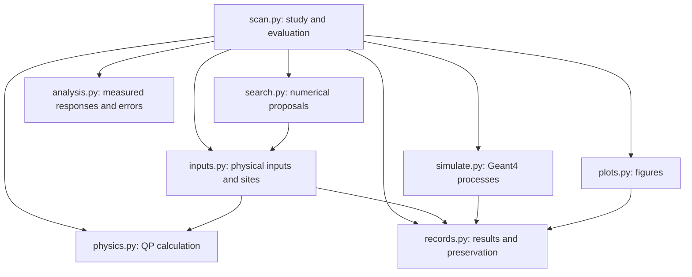

# Implementation and scientific verification

Date: 2026-10-14. Comparison source:
`Material_optimization_v3_scan_parameters_revised`,
`c8cdb996209711bef0e266c7315bfa518eda47e8`.
Implementation branch:
`Material_optimization_v3_scan_parameters_further_revised`.

The proposed eight working scripts and two test scripts are implemented. All
scientific studies use one evaluator, one process queue and one result writer.
Historical raw data, databases, snapshots, material tables and macros are
preserved. The 73 superseded Python/Bash/notebook files are available at the
comparison revision; no compatibility package remains in the working tree.

## Structure and computational work

| Measure | Previous source | Current source |
|---|---:|---:|
| All source files, including tests, Bash and notebook | 73 | 10 |
| Working files, excluding tests | 66 | 8 |
| Working Python lines, including blanks | 22,566 | 4,391 |
| Working Python functions and methods | 682 | 150 |
| Working Python classes | 78 | 3 |
| Working Bash files | 11 | 0 |
| Notebook files | 1 | 0 |

Counts come from Python syntax trees and the source inventory in
[`verification/structure.json`](verification/structure.json). Working Python
lines fall by 80.5%; functions by 78.0%.
These are structural measures, not execution-time estimates. The only stateful
classes are `GaussianProcess`, `CMAES`, and `Results`. Working code contains
one comment token and 47 short docstring lines;
scientific explanation lives in Markdown. Tests are excluded from those counts.

Physics no longer imports a simulation driver or SALib. Search uses physical
coordinate transforms directly. One parent controls process limits and writes
SQLite; workers return files and completion information. At most twice the
worker count is submitted concurrently. Candidate threads do not create more
thread pools. The external installation environment is sourced once.

QP totals are accumulated without allocating a time matrix unless requested.
Selected CSV columns are read in chunks. Region arrays are prepared once for
bootstrap draws. Area fractions are estimated in chunks once per new geometry;
recorded weights are reused. Gaussian-process calculations use triangular
solves and incremental Cholesky updates. ODE-only Morris moves reuse transport.

| Isolated calculation | Previous | Current | Measured ratio |
|---|---:|---:|---:|
| 20,000 hits: previous vector time matrix versus required totals | 7.339 ms | 2.815 ms | 2.61× |
| 2,361 sites × 8 realizations, 1,000 bootstrap draws | 1.136 s | 0.523 s | 2.17× |
| GP likelihood, 192 observations | 8.498 ms | 5.124 ms | 1.66× |
| GP Cholesky append, 204 observations | 4.486 ms | 0.249 ms | 18.00× |

The older scalar hit loop took 1.539 s for the same dense synthetic input.
That 547× comparison describes replacement of the old loop; 2.61× is the more
relevant comparison with the previous package's vector calculation. These
measurements exclude CSV reading and Geant4. Sparse physical hit files can be
dominated by file opening. Sources and numerical differences are recorded in
[physics checks](verification/physics_reference_comparison.json) and
[search checks](verification/search_reference_comparison.json).

The live eight-realization runs took 88.54 s previously and 86.11 s now, with
eight workers each. This single pair of timings does not establish an overall
speed gain; transport dominates and no repeated timing study was performed.

## Deterministic numerical comparisons

| Calculation | Comparison result |
|---|---|
| Cubic sound speeds, four stiffness/density combinations | Exact retained values |
| Nine calibrated interface combinations | Exact probabilities |
| Saved 32 hit files, 113 rows, 672 QPs | Exact electrode totals and every time bin |
| Four saved 128/512-site reference/SiC examples | Exact means, bootstrap errors, tails and leverage |
| Saved paired 128/512-site differences | Exact differences and errors |
| Nine linked substrate/film combinations | Exact density, speeds, rounded absorption and film inputs |
| Active 25-dimensional Morris design, four complete trajectories | Exact 104 sampled points; 80 transport settings, 24 ODE reuses |
| Random and Sobol, 24 observations each | Exact proposals and restart |
| CMA-ES, 12 complete generations, 96 observations | Exact proposals, mean, covariance and step size |
| GP fixed-fit means and standard deviations | Maximum differences 3.29e-14 and 1.91e-14 |

Linked-material diagnostic impedances differ by at most 0.0013 on a roughly
1e7 scale because of retained speed rounding; rendered absorption commands
match. Details are in [linked-material checks](verification/linked_material_reference_comparison.json)
and [Morris checks](verification/morris_reference_comparison.json).

Small GP arithmetic changes can alter later optimization choices. The short
proposal comparison differs by at most 9.23e-9 in unit coordinates, but long
search paths can diverge. An eight-seed synthetic noisy-objective experiment
used 32 observations and four noisy replicates per observation. The mean
relative difference in the best true objective was −0.669%, with a paired
Student-t 95% interval [−3.359%, +2.021%]. This is limited synthetic evidence;
it does not validate a complete physical GP-versus-CMA comparison.

Two deliberate changes prevent misleading results: CMA-ES updates require a
complete population, and failed transport contributes no measured objective.
An incomplete final CMA generation is reported as measured but unused in a
population update. Identical old scheduling is not a requirement when it
violated that numerical condition.

## Live stochastic comparison

Each implementation simulated Si/Nb/Cu at the same 16 Sobol sites, eight
realizations, and 31,250 primaries per site-realization task: 128 completed tasks
and 4,000,000 primaries per implementation. All 128 normalized macros and all
128 lattice records matched numerically. Output paths and completion-witness
paths are excluded from the macro comparison. Executable and loaded-library
hashes are recorded in [the comparison](verification/live_eight_replica_comparison.json).

Let $Y_r$ be the summed junction-QP yield per primary in realization $r$,
averaged over the fixed sites. Define $D_r=Y_r^{\rm new}-Y_r^{\rm previous}$.
For $R=8$, the measured difference and its standard error are

$$
\bar D=R^{-1}\sum_rD_r,\qquad
s_{\bar D}=\sqrt{\frac{\sum_r(D_r-\bar D)^2}{R(R-1)}}.
$$

The interval is $\bar D\pm t_{0.975,7}s_{\bar D}$. Shared sites and random
streams justify this paired comparison; a non-significant difference alone
would not establish agreement. The allowed relative difference, fixed before
the comparisons, is ±5% of the previous mean. Agreement requires the whole
interval inside that range.

| Quantity | Measured value |
|---|---:|
| Previous QPs | 1,534 |
| New QPs | 1,526 |
| Previous $\bar Y$ | 3.835e-4 QPs/primary |
| New $\bar Y$ | 3.815e-4 QPs/primary |
| $\bar D$ | −2.000e-6 QPs/primary |
| $s_{\bar D}$ | 2.828e-6 QPs/primary |
| Paired 95% interval | [−8.688e-6, +4.688e-6] QPs/primary |
| Relative change and interval | −0.522%; [−2.265%, +1.222%] |
| Predeclared ±5% agreement criterion | Pass |

An earlier four-realization pilot produced 702 versus 712 QPs from 2,000,000
primaries per implementation. Its interval [−3.109%, +5.958%] crossed the +5%
limit, so it did **not** establish the declared agreement. That result is kept
in [the pilot record](verification/live_four_replica_comparison.json). The larger
follow-up used fresh executions and was selected after the pilot; the quoted
interval is a descriptive single-comparison interval, without a correction
for choosing a follow-up after inspecting the pilot.

This establishes reference software agreement at the stated tolerance. It does
not establish convergence of the 16-site spatial integral, equality for every
material, or accuracy of the calibrated interface model. The realization
interval measures transport variation on fixed sites; spatial and model errors
are separate quantities. Raw validation trees remain locally under
`material_scan_data/validation/`; the compact numerical records are in Git.

## Workflow checks and project goals

The final suite contains 77 tests in the two test files. It requires
saved fixtures and rejects missing ones. Tests cover independent physical
examples and failure/recovery behavior; their count is not a one-for-one
replacement for the earlier 194 individually printed legacy checks.

| Project goal in the scientific notes | Implemented and checked | Remaining scientific evidence |
|---|---|---|
| Physical feasibility before simulation | Cubic stability, Christoffel modes, units, threshold/gap checks, density and complete cubic lattice records | Material-specific measured inputs |
| Morris sensitivity | Complete trajectories, recorded inputs for reanalysis, pooled retained density evolution, ODE transport reuse | More independent trajectories; pooled nonlinear density uncertainty is absent |
| Linked materials | Own native lattice and density; linked films; shared evaluator | Full-spatial confirmation of measured property sets |
| Continuous-property search | Random/Sobol/GP/CMA, saved pending proposals, atomic search history, failed-point handling | Matched independent physical GP/CMA comparisons |
| Spatial integration | Recorded area weights, nested positions/seeds, regional checks, errors, leverage and ranking | Verify the origins of the existing 2,361-site studies before reuse |
| Tolerance and projection | Transformed-coordinate perturbations, skipped moves labelled untested, measured-feature distances and missing-field counts | Supported property ranges and actual shortlisted material simulations |
| Time-dependent response | Retained QP time ties and density calculation; requested time files verified by SHA-256 | Calibrated conversion to qubit errors |
| Reliable measurements | Completion witness, strict CSV checks, runtime material/density, owned-process limits, explicit physical zero | Broader live materials and long-running transport checks |
| Preservation and recovery | One writer, immutable task declarations, late-result rejection, checksums, stopped-copy conversion, deterministic archive/recovery | A second independently stored copy before any future data removal |
| Figures | Recorded values and units, layouts/hits/time/sensitivity/search/convergence/projection; recovered paths | New figures from completed physical studies |

Integration tests exercise interrupted pending searches and interrupted
post-update saves, failed CMA members, incomplete series, corrupted cached
outputs, malformed files, missing completion, witnessed exit-time faults,
timeouts, database aliases, late attempts, and archive corruption. Recovery
reproduces the same response/error after the original output directory is
removed, without simulation or database changes. Time figures reject corrupted
arrays and all yield axes follow recorded units.

All eight example YAML files pass input checks, including every child of a
sequence/refinement. On the actual eight-realization output, read-only
reanalysis matches the response and error exactly; restarting reuses all 128
tasks; archive/recovery reproduces the response; layout, hit and summary figures
render. Historical SQLite checksums remain unchanged during inspection. See
[study checks](verification/study_checks.json) and
[live workflow checks](verification/live_workflow.json).

Source validation uses Python 3.12.13, NumPy 2.4.6, SciPy 1.17.1, and SALib
1.5.2 in the existing G4CMP environment. Optional Materials Project network
retrieval, Optuna/TPE, and live Ollama proposals were not newly exercised.
Unavailable optional software fails explicitly. The current simulator remains
external; its inputs and executable/library identities are recorded per study.

## Next scientific work

The tracked September notes end at 512 sites. Later local reports inspected
here record convergence of reference, SiC-elasticity and niobium-compatible
anchors at 2,361 sites and eight realizations. They also report unused-seed
confirmations of three CMA runs: two leaders remain statistically tied and the
finalists reach the $C_{44}=5$ GPa lower limit. These are inherited findings;
this restructure did not rerun their full simulations. Their report text and
SHA-256 values are preserved in
[previous local reports](verification/previous_local_reports.json).

1. Match those later reports to their frozen sites, weights, physical inputs,
   completed task sets and raw-file identities. Recompute their summaries with
   the new analysis before treating that design or those values as reusable.
2. Fix the intended operating temperature and retain
   $\Delta_{\rm film}\geq1.5384\times10^{-3}$ eV. Test tolerance around the 5 GPa
   $C_{44}$ edge and restrict or extend ranges only with physical support.
3. Complete at least three independent GP/CMA comparisons with the same
   starting points and numbers of measured evaluations. Diagnose slow transport
   before large GP runs; failed/timed-out points remain absent responses.
4. Confirm diverse feasible finalists on the verified full spatial design with
   unused random streams. Treat the currently tied leaders as unresolved.
5. Obtain SiC scattering, total decay and transverse-transverse decay values;
   bracket film lifetimes and independently justified interface models. Only
   then reconsider real-material or fabrication claims. Logical-error claims
   additionally require a measured time-dependent QP-to-error relation.
